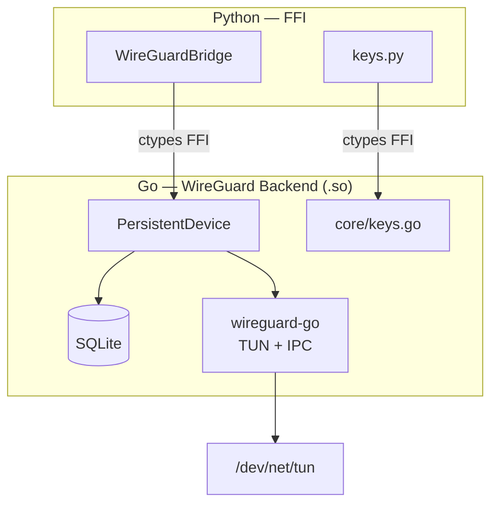
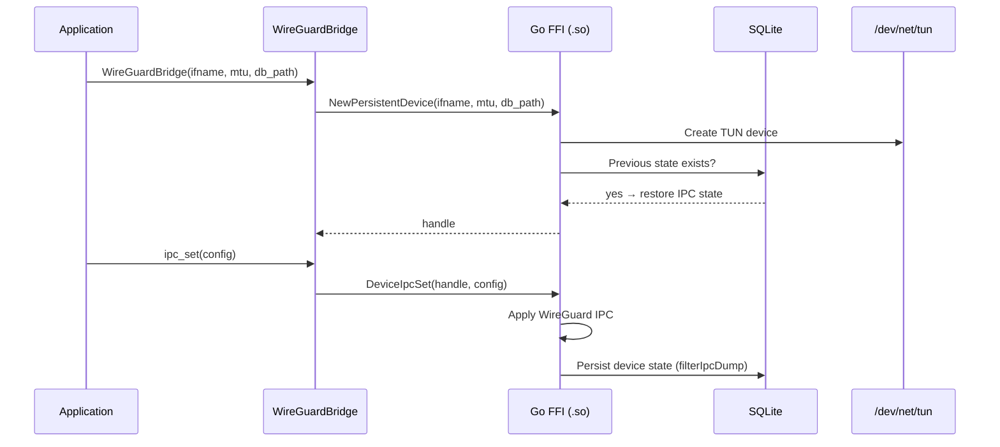
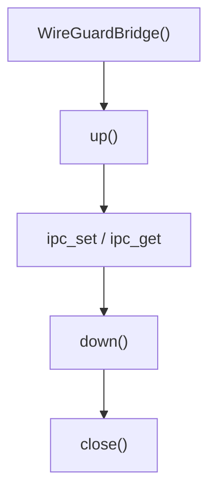

# wireguard-go-bridge

Userspace WireGuard — Go backend, SQLite IPC state persistence, Python FFI.

- Go backend: wireguard-go TUN device + IPC protocol, every `ipc_set` persisted to SQLite.
- Python layer: ctypes FFI binding, key generation, bridge lifecycle.
- No kernel module required — fully userspace.

## Download

Each version is a tagged release. Pick one and take its assets:

```
https://github.com/ARAS-Workspace/phantom-wg/releases/download/vendor-wireguard-go-bridge-v<X.Y.Z>/linux-amd64.zip
https://github.com/ARAS-Workspace/phantom-wg/releases/download/vendor-wireguard-go-bridge-v<X.Y.Z>/linux-arm64.zip
```

Each zip extracts to:

```
wireguard_go_bridge/
├── __init__.py
├── _ffi.py
├── bridge.py
├── keys.py
├── types.py
├── wireguard_go_bridge.so
├── wireguard_go_bridge.so.sha256
├── VERSION
├── LICENSE
├── THIRD_PARTY_LICENSES
└── licenses/
```

Releases are listed at [https://github.com/ARAS-Workspace/phantom-wg/releases](https://github.com/ARAS-Workspace/phantom-wg/releases); this component's tags carry the
`vendor-wireguard-go-bridge-` prefix. The version in this branch is in
[`wireguard_go_bridge/__init__.py`](wireguard_go_bridge/__init__.py)
(`__version__`).

## Architecture



## Database

Go backend persists state to SQLite with a single table:

```sql
CREATE TABLE IF NOT EXISTS ipc_state (
    id    INTEGER PRIMARY KEY CHECK (id = 1),
    dump  TEXT NOT NULL
);
```

The `dump` column holds the device state in WireGuard IPC protocol format (private key, listen port, peers), without the handshake time, the byte counts and `protocol_version`. Overwritten on every `ipc_set` call, restored on startup via `restore()`.

## Layers

| Layer                  | Responsibility                                               |
|------------------------|--------------------------------------------------------------|
| `bridge.py`            | WireGuardBridge lifecycle — create, ipc_set, up, down, close |
| `keys.py`              | Key generation — private, public, preshared, hex↔base64      |
| `_ffi.py`              | cdylib load, ctypes binding                                  |
| `types.py`             | Error types                                                  |
| `persistent_device.go` | WireGuard device + automatic IPC state persistence           |
| `exports.go`           | C FFI export layer — public API surface                      |
| `core/keys.go`         | Curve25519 key generation                                    |
| `core/registry.go`     | Handle registry — device handle management                   |

## Loading

```python
from wireguard_go_bridge import WireGuardBridge

bridge = WireGuardBridge(
    ifname="wg_phantom_main",
    mtu=1420,
    db_path="/var/lib/phantom/state/db/wireguard/wg_phantom_main/device.db",
)
```

## IPC Configuration Format (UAPI)

```text
private_key={hex}
listen_port={int}
replace_peers=true
public_key={hex}
preshared_key={hex}
allowed_ip={ipv4}/32
allowed_ip={ipv6}/128
persistent_keepalive_interval={int}
```

## Key Generation

```python
from wireguard_go_bridge.keys import (
    generate_private_key,
    derive_public_key,
    generate_preshared_key,
)

private = generate_private_key()       # Curve25519 (hex)
public  = derive_public_key(private)   # Public key (hex)
psk     = generate_preshared_key()     # PSK (hex)
```

## Exception Types

A bridge call that fails returns a negative code, or NULL when it returns
a string, and records the code and a message as the calling thread's last
error; a call that succeeds clears the record. `BridgeVersion`,
`FreeString` and `LastError` leave the record as it is.
`LastError(int32_t* code)` returns a copy of the message, to be freed
with `FreeString`, and writes the code. The record is per
thread: ctypes releases the GIL during a call, and each Python thread
reads the record of its own call. The Python layer reads it after a
failure and raises the exception of the code with the bridge's message:

```python
try:
    bridge.up()
except DeviceNotFoundError as e:
    e.code   # -5
    str(e)   # "device handle 7 not found"
```

| Code | Exception              | Description                                                     |
|------|------------------------|-----------------------------------------------------------------|
|      | `BridgeError`          | Base error class; `code` holds the bridge's code                |
| -2   | `TunCreateError`       | TUN interface creation failure, a `DeviceCreateError`           |
| -3   | `DeviceCreateError`    | Device creation failure                                         |
| -4   | `IpcError`             | IPC set or get failure                                          |
| -5   | `DeviceNotFoundError`  | No device for the handle                                        |
| -7   | `DeviceUpError`        | Interface activation failure                                    |
| -8   | `DeviceDownError`      | Interface deactivation failure                                  |
| -10  | `InvalidArgumentError` | Argument refused, such as a key that is not hex; a `ValueError` |
| -99  | `BridgeError`          | Internal error, a recovered panic among them                    |

A key the bridge refuses raises `InvalidArgumentError`, a `ValueError`,
with code -10. Any other failure of a key function raises `RuntimeError`
from the generate functions and `ValueError` from `derive_public_key` and
`hex_to_base64`, with the bridge's message when the bridge recorded one.

## State Persistence



## Lifecycle



## Directory Structure

```
wireguard-go-bridge/
├── src/                        # Go — WireGuard backend
│   ├── main.go                 # cgo entry
│   ├── exports.go              # C FFI exports
│   ├── persistent_device.go    # Device + SQLite persistence
│   ├── handle_registry.go      # Device handle management
│   ├── guards.go               # Panic containment + error record
│   ├── lasterror.go            # Calling thread's last error
│   ├── thread_id.go            # pthread_self, the record's key (cgo)
│   ├── errors.go               # Errors with the code of their export
│   ├── version.go              # BridgeVersionStr
│   ├── wireguard_go_bridge.h   # C FFI header (error codes)
│   ├── exports.map             # Linker version script: exported symbols
│   └── core/
│       ├── keys.go             # Curve25519 key ops
│       └── registry.go         # Handle registry
├── wireguard_go_bridge/        # Python — FFI + keys
│   ├── __init__.py             # public API, __version__
│   ├── bridge.py               # WireGuardBridge wrapper
│   ├── keys.py                 # Key generation utilities
│   ├── _ffi.py                 # ctypes bindings
│   └── types.py                # error types
├── tests/                      # Unit + integration tests
└── .github/
    ├── workflows/              # CI/CD
    └── scripts/publish.sh      # release publish trigger
```

## Development

```bash
# Go tests, in the image CI runs them in
docker run --rm -v "$PWD:/workspace" -w /workspace/src golang:1.27.3-trixie go test -race -v ./...

# Test (Go build + pytest inside Docker container)
python test_runner.py

# Publish (triggers workflow_dispatch)
.github/scripts/publish.sh
```

## Version

Single source of truth: `wireguard_go_bridge/__init__.py` → `__version__`

Go side: `src/version.go` → `BridgeVersionStr` (validated to match during publish).

## Package Verification

The zip carries its own hash: `wireguard_go_bridge.so.sha256` sits next to
the library it describes, so the package can be checked after extraction
without fetching anything.

```bash
unzip -q linux-amd64.zip
cd wireguard_go_bridge && sha256sum -c wireguard_go_bridge.so.sha256
```

The zip itself is attested by the release it came from. GitHub records a
digest for every asset; `gh` prints it:

```bash
gh release view vendor-wireguard-go-bridge-v<X.Y.Z> \
  --repo ARAS-Workspace/phantom-wg --json assets \
  --jq '.assets[] | "\(.name) \(.digest)"'
```

## License

AGPL-3.0 — [LICENSE](LICENSE) | [THIRD_PARTY_LICENSES](THIRD_PARTY_LICENSES)
