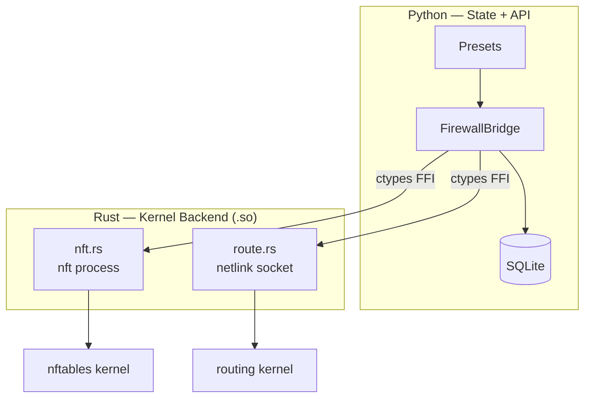
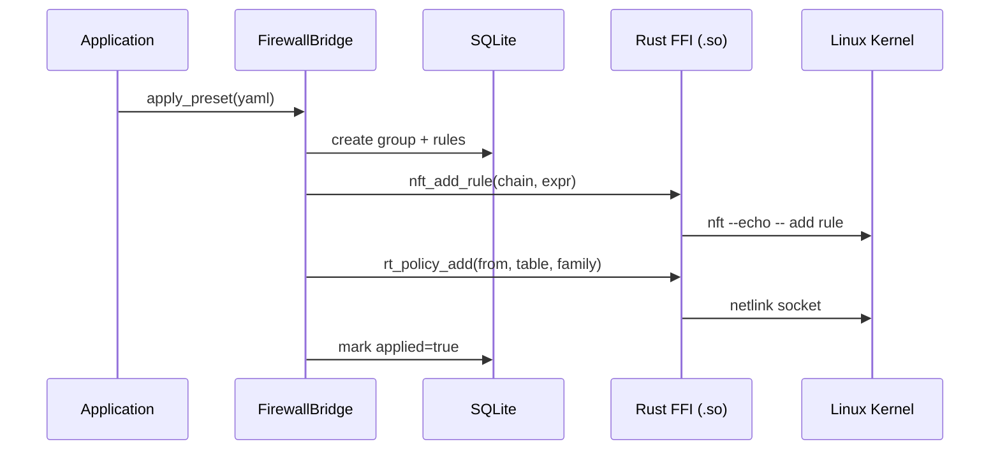
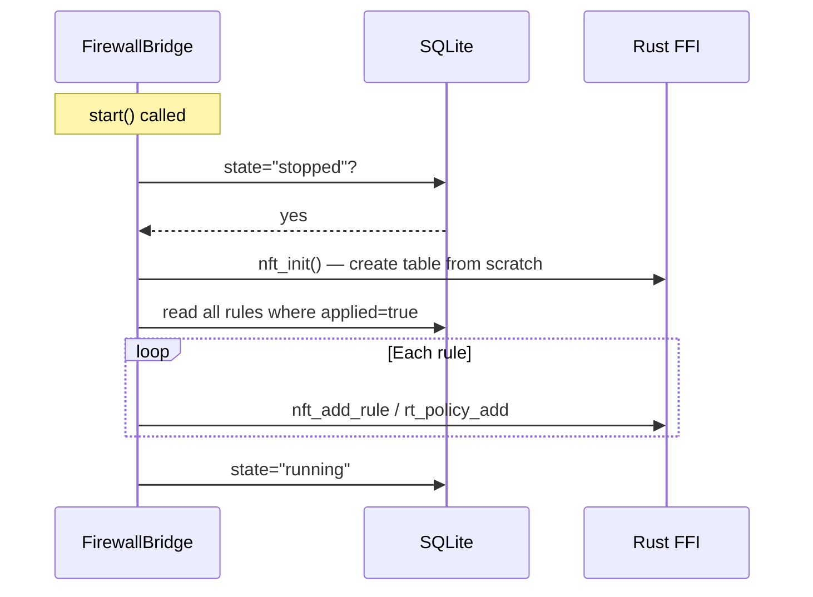
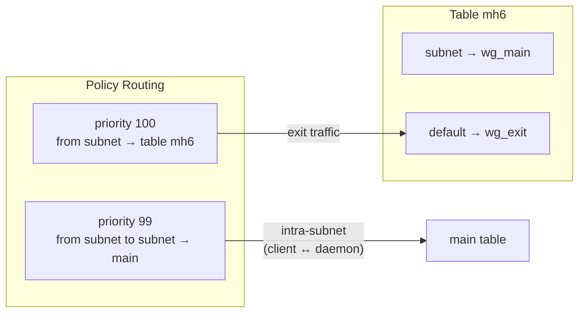

# firewall-bridge

Linux firewall manager — nftables + policy routing, SQLite state, YAML presets.

- Rust backend talks to the kernel through a netlink socket and the nft program.
- Python layer provides state machine, DB persistence and preset system.

## Download

Each version is a tagged release. Pick one and take its assets:

```
https://github.com/ARAS-Workspace/phantom-wg/releases/download/vendor-firewall-bridge-v<X.Y.Z>/linux-amd64.zip
https://github.com/ARAS-Workspace/phantom-wg/releases/download/vendor-firewall-bridge-v<X.Y.Z>/linux-arm64.zip
```

Each zip extracts to:

```
firewall_bridge/
├── __init__.py
├── _ffi.py
├── bridge.py
├── db.py
├── models.py
├── presets.py
├── schema.py
├── types.py
├── schemas/
│   └── schema.sql
├── libfirewall_bridge_linux.so
├── libfirewall_bridge_linux.so.sha256
├── firewall_bridge_linux.h
├── VERSION
├── LICENSE
└── THIRD_PARTY_LICENSES
```

Releases are listed at [https://github.com/ARAS-Workspace/phantom-wg/releases](https://github.com/ARAS-Workspace/phantom-wg/releases); this component's tags carry the
`vendor-firewall-bridge-` prefix. The version in this branch is in
[`firewall_bridge/__init__.py`](firewall_bridge/__init__.py) (`__version__`).

## Requirements

- glibc 2.39 or later
- A Linux kernel: 5.15, 6.1 and 6.12 are tested, see [Kernel Compatibility](#kernel-compatibility)
- The `nft` program from the `nftables` package (`/usr/sbin/nft`)
- `CAP_NET_ADMIN` that child processes inherit
- `SIGCHLD` left at its default disposition
- A writable `/etc/iproute2` directory

**glibc.** The release `.so` is built in the `rust:<version>-trixie` image (glibc 2.41) and
requires `GLIBC_2.39`. Systems with an older glibc, such as Debian bookworm (glibc 2.36),
therefore cannot load the library. This is the glibc of the system or container that loads the
library, for example the daemon's container; the kernel is the host's. In the kernel matrix
below, the library runs in Debian trixie containers on Ubuntu 22.04 and Debian 12 hosts.

**The nft program.** By default the bridge applies nftables rules through `/usr/sbin/nft`. If
the program is elsewhere, its location is given in the `FIREWALL_BRIDGE_NFT_PATH` environment
variable; the variable accepts an absolute path only.

**CAP_NET_ADMIN.** nft runs as a separate process, so the capability has to pass from the
process that loads the bridge to this child process. For that, the process either runs as root
or holds `CAP_NET_ADMIN` as an ambient capability. A capability that is effective only in the
loading process, for example one given to the interpreter with `setcap`, does not reach nft.
Phantom-WG's daemon container runs as root with `cap_add: [NET_ADMIN, NET_RAW]`.

**SIGCHLD.** The bridge waits for every nft process it starts to finish before the call
returns, whether the process succeeds, fails or is ended by a signal. No process is therefore
left behind as a zombie, also when the process that loads the bridge runs as PID 1 in a
container without an init. If `SIGCHLD` is set to `SIG_IGN`, the kernel reaps the child itself;
the call then returns an error even though the command was applied.

**/etc/iproute2.** The bridge writes routing table names to `/etc/iproute2/rt_tables`. If the
file does not exist, it is created as a copy of `/usr/share/iproute2/rt_tables` before the
bridge's table names are added.

## Kernel Compatibility

The bridge works with the running kernel through nft and a netlink socket: the kernel is always
the host's, while glibc and nft are those of the system or container that loads the library.
[`kernel-matrix-firewall-bridge.yml`](.github/workflows/kernel-matrix-firewall-bridge.yml) boots
each release in the table under KVM, from its first cloud image with that image's kernel, and
runs the steps of the test workflow in it: the Rust tests in the dev container, the Python unit
tests and the three E2E stages (topology, rules, rules-caps). On every host the containers are
Debian trixie (`rust:1.99.1-trixie`, `debian:trixie-slim`) with nftables 1.1.3, and Docker CE is
29.8.0. The workflow runs on each push to `dev/firewall-bridge`.

| Host                  | Kernel                | Rust tests          | Python unit tests | E2E stages    | Status        |
|-----------------------|-----------------------|---------------------|-------------------|---------------|---------------|
| Ubuntu 22.04 (GA)     | `5.15.0-25-generic`   | 84 passed           | 312 passed        | 3 of 3 passed | in the matrix |
| Debian 12.0           | `6.1.0-9-amd64`       | 84 passed           | 312 passed        | 3 of 3 passed | in the matrix |
| Debian 13.0           | `6.12.38+deb13-amd64` | 84 passed           | 312 passed        | 3 of 3 passed | in the matrix |
| Debian 11.0           | `5.10.0-8-amd64`      | 82 passed, 2 failed | 312 passed        | not run       | removed       |

The first three rows are run
[41551902856](https://github.com/ARAS-Workspace/phantom-wg/actions/runs/41551902856) at
`aae7d5cb` (2026-11-03); its summary lists each guest's kernel, the exit code and seconds of each
step, and the test results. The Debian 11 row is run
[41542386316](https://github.com/ARAS-Workspace/phantom-wg/actions/runs/41542386316) at
`6346d1b8` (2026-11-02).

**Tested kernels.** Each release is tested with the kernel of its first image, and 5.15 is the
lowest kernel in the matrix. Later kernels of these releases, such as Ubuntu 22.04's HWE kernels,
and kernels between and after the three above are not in the matrix.

**nft's messages depend on the kernel.** When the kernel refuses a chain that exists with another
declaration, the same nft 1.1.3 reports `Error: Chain "output" already exists ...` on 6.12 and
`Error: Could not process rule: File exists` on 5.10, 5.15 and 6.1. The bridge returns nft's
message as its error text, so a caller sees either one.

**Debian 11 (5.10), removed from the matrix.** In run 41542386316:

- `kernel_nft_builds_what_nft_builds_from_text` failed: on 5.10, nft's `--echo --json --handle`
  output for an added rule has no handle. The test takes its reference rule from that output; the
  bridge's own call for the same rule returned a handle.
- `kernel_nft_ensure_table_is_all_or_nothing` failed on the message above. Since `d4d4622e` the
  test accepts it; its other checks have not run on 5.10.
- The E2E stages did not run: the E2E runner on the host needs Python 3.10 (compose-bridge uses
  `dataclass(slots=True)`), and Debian 11 has Python 3.9.

## Architecture



## Layers

| Layer        | Responsibility                                |
|--------------|-----------------------------------------------|
| `bridge.py`  | State machine, DB CRUD, FFI dispatch          |
| `presets.py` | YAML parse, group create, batch rule apply    |
| `db.py`      | SQLite persistence, migration, WAL mode       |
| `_ffi.py`    | cdylib load, ctypes binding                   |
| `nft.rs`     | nftables chain/rule CRUD — nft process        |
| `route.rs`   | Policy routing + route table — netlink socket |

## Data Flow



## Crash Recovery



DB is the source of truth. Kernel state is rebuilt from DB on every start. A daemon restart is sufficient after a crash.

## Preset Structure

```yaml
name: multihop-exit-v6
priority: 80
metadata:
  description: Forward IPv6 traffic wg_main to wg_exit

table:
  - ensure: {id: 201, name: mh6, family: 10}
  - policy: {from: "fd00:10:1::/64", to: "fd00:10:1::/64", table: main, priority: 99, family: 10}
  - policy: {from: "fd00:10:1::/64", table: mh6, priority: 100, family: 10}
  - route:  {destination: default, device: wg_exit, table: mh6, family: 10}

rules:
  - chain: forward
    action: accept
    family: 10
    in_iface: wg_main
    out_iface: wg_exit
  - chain: postrouting
    action: masquerade
    family: 10
    source: "fd00:10:1::/64"
    out_iface: wg_exit
```

`family: 10` = AF_INET6, `family: 2` (default) = AF_INET.

## Dual-Stack IPv6



The priority 99 rule routes intra-subnet traffic (client replies) through the main table. Without it, reply packets would be sent to the exit tunnel.

## Directory Structure

```
firewall-bridge/
├── src/                    # Rust — kernel backend
│   ├── lib.rs              # FFI export, nft context
│   ├── nft.rs              # nftables chain/rule ops
│   ├── route.rs            # netlink policy routing
│   └── error.rs            # error codes
├── include/
│   └── firewall_bridge_linux.h  # C FFI header
├── firewall_bridge/        # Python — state + API
│   ├── __init__.py         # public API, __version__
│   ├── bridge.py           # FirewallBridge state machine
│   ├── db.py               # SQLite persistence + migration
│   ├── models.py           # Group, FirewallRule, RoutingRule
│   ├── presets.py          # YAML preset applicator
│   ├── schema.py           # preset validation
│   ├── _ffi.py             # ctypes bindings
│   ├── types.py            # error types
│   └── schemas/schema.sql  # DB schema
├── tests/                  # Unit tests (Docker SDK runner)
├── e2e_tests/              # E2E tests (compose-bridge)
├── dev/                    # Local dev tools
└── .github/
    ├── workflows/          # CI/CD
    └── scripts/publish.sh  # release publish trigger
```

## Development

```bash
# Rust tests: unit tests, and kernel tests (nft, netlink) that need the
# privileged dev container dev/cargo.sh starts
dev/build.sh && dev/cargo.sh test --lib

# Clippy in the dev container, every warning an error
dev/clippy.sh

# Python unit tests
python tests/runner.py

# E2E tests (compose-bridge required)
bash fetch_compose_bridge.sh
python e2e_tests/runner.py

# Publish (triggers workflow_dispatch)
.github/scripts/publish.sh
```

## Version

Single source of truth: `firewall_bridge/__init__.py` → `__version__`

CI/CD, publish workflow and VERSION file are all derived from this value.

## Package Verification

The zip carries its own hash: `libfirewall_bridge_linux.so.sha256` sits next to the library it
describes, so the package can be checked after extraction without fetching
anything.

```bash
unzip -q linux-amd64.zip
cd firewall_bridge && sha256sum -c libfirewall_bridge_linux.so.sha256
```

The zip itself is attested by the release it came from. GitHub records a
digest for every asset; `gh` prints it:

```bash
gh release view vendor-firewall-bridge-v<X.Y.Z> \\
  --repo ARAS-Workspace/phantom-wg --json assets \\
  --jq '.assets[] | "\\(.name) \\(.digest)"'
```

## License

AGPL-3.0 — [LICENSE](LICENSE) | [THIRD_PARTY_LICENSES](THIRD_PARTY_LICENSES)
