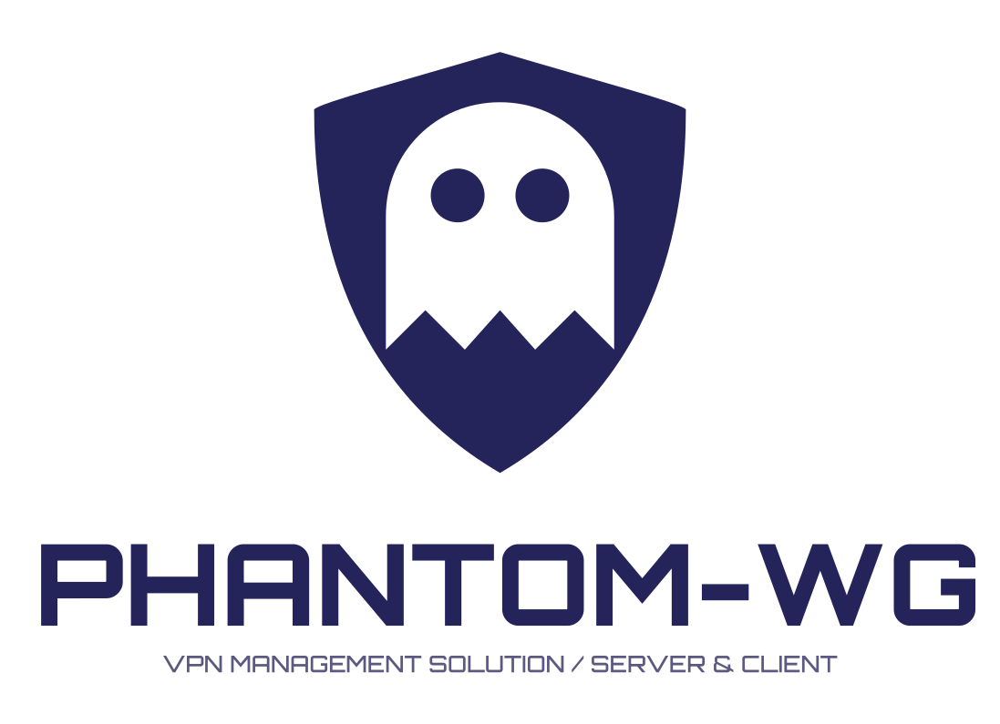
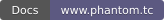
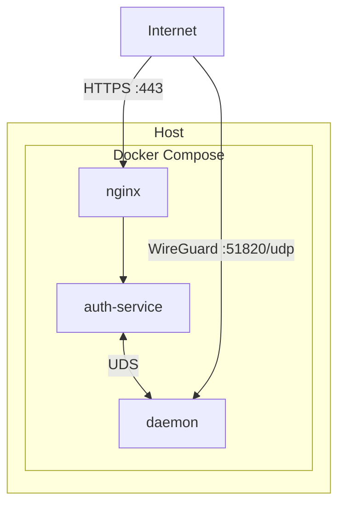
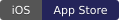

<div align="center">

<picture>
  <source media="(prefers-color-scheme: dark)" srcset="https://raw.githubusercontent.com/ARAS-Workspace/phantom-wg/press-kit/assets/phantom-vertical-master-stellar-silver.svg">
  <source media="(prefers-color-scheme: light)" srcset="https://raw.githubusercontent.com/ARAS-Workspace/phantom-wg/press-kit/assets/phantom-vertical-master-midnight-phantom.svg">
  
</picture>

[](LICENSE)
[](https://www.phantom.tc/docs)

</div>

## What is Phantom-WG?

***Phantom-WG*** is a VPN management solution built on WireGuard that you run in your own server environment. It offers a web dashboard on the server side and signed applications for macOS and iOS on the client side. A separate and optional front node (**Phantom-Frontmatter**) carries connections as WebSocket Secure over TCP 443. This way, clients can also connect from networks where UDP is restricted.

Phantom-WG is made of several products. They fall into two groups by where they run, the server side and the client side:

- **Server side:** Phantom-WG Modern, Phantom-Frontmatter
- **Client side:** Phantom-WG Mac, Phantom-WG iOS

> [!IMPORTANT]
> **Running 1.1.5?** The steps to move to 2.0.0 are in the [Migration Guide](https://github.com/ARAS-Workspace/phantom-wg/blob/press-kit/MIGRATION.md). 2.0.0 brings architectural changes. The old automatic update flow is not suitable for moving to this version. The steps of the [Migration Guide](https://github.com/ARAS-Workspace/phantom-wg/blob/press-kit/MIGRATION.md) need to be followed with care.

---

## Phantom-WG Modern Installation and Configuration

Phantom-WG comes with three core containers managed by Docker Compose. The diagram shows the container topology.



### Requirements

| Requirement      | Detail                                                                             |
|------------------|------------------------------------------------------------------------------------|
| Operating system | Linux, kernel 5.15 or newer                                                        |
| Docker           | Docker Engine 27.0.1 or newer, Docker Compose plugin 2.27.2 or newer               |
| Python           | `python3` 3.9 or newer                                                             |
| TUN              | `/dev/net/tun`                                                                     |
| Tools            | `bash`, `git` to install from a clone and to update, `unzip` for a release archive |
| User             | A member of the `docker` group, or root                                            |

#### Install Matrix

The install is tested on the current image of eight distributions by the [`Verify install matrix`](https://github.com/ARAS-Workspace/phantom-wg/actions/runs/42452212400) workflow. On each distribution Docker is installed, the server reboots, and the project's own tool set runs the `setup`, `up`, authenticated check, `down`, `hard-reset` steps for two rounds. Last run (8 November 2026):

| Distribution   | Kernel | Docker Engine | Docker Compose |
|----------------|--------|---------------|----------------|
| Ubuntu 22.04   | 5.15   | 29.9.3        | 5.7.0          |
| Ubuntu 24.04   | 6.8    | 29.9.3        | 5.7.0          |
| Ubuntu 26.04   | 7.0    | 29.9.3        | 5.7.0          |
| Debian 12      | 6.1    | 29.9.3        | 5.7.0          |
| Debian 13      | 6.12   | 29.9.3        | 5.7.0          |
| Fedora 45      | 7.2    | 29.9.3        | 5.7.0          |
| Arch Linux     | 7.2    | 29.9.3        | 5.7.0          |
| AlmaLinux 10.2 | 6.12   | 29.9.3        | 5.7.0          |

### 1. Download

There are two ways to download the Phantom-WG Modern distribution to your server. They differ in where the images come from and in how updates are handled.

#### Git Clone

A git clone takes the distribution from the `main` branch of the GitHub repository. The `main` branch carries the latest published release. This method suits servers with internet access.

```bash
git clone --depth 1 --branch main https://github.com/ARAS-Workspace/phantom-wg.git
cd phantom-wg
```

- `--depth 1` takes only the last commit of `main`. The update flow moves the clone forward from there.
- The images are pulled from the registry during setup. Which image is used is fixed by the distribution. The image addresses and digests are in [`tools/compose/registry.yml`](tools/compose/registry.yml).
- A new release is taken in the same directory with `./tools/prod.sh update`.
- Required tool: `git`.

#### Release Archive

The release archive carries the images inside it, and they are installed without reaching the registry. This method is ideal for offline installs, but it does not include in-place update support (git) by default. The operator has to handle the update process manually.

Download the file for your architecture from the [Releases](https://github.com/ARAS-Workspace/phantom-wg/releases) page:

```bash
uname -m                                       # x86_64: amd64, aarch64: arm64
unzip phantom-wg-modern-v<version>-amd64.zip   # or -arm64
cd phantom-wg-modern
```

- There is one archive per architecture: `amd64` and `arm64`.
- The images are in the `images/` directory of the archive. `setup` loads them after checking their checksums.
- The `update` command stops on this install. A new release is installed from its own archive.
- Required tool: `unzip`.

### 2. Setup

```bash
./tools/prod.sh gates    # reports what the host provides
./tools/prod.sh setup
```

`setup` creates what is missing, in this order:

1. `.env`, `.env.daemon`, `.env.auth-service` and `docker-compose.override.yml` (each from its own `.example` file)
2. WireGuard server key pair
3. Auth-service keys, the `admin` account and the database
4. Self-signed TLS certificate
5. Address pool

By default, clients take their addresses from the `10.8.0.0/24` pool. Another subnet can be given only at the first setup:

```bash
./tools/prod.sh setup --terazi-ipv4-subnet=10.9.0.0/24
```

**Terazi** is the architecture that handles the address pool in Phantom-WG. It pairs IPv4 and IPv6 addresses through the same index. For this reason a single IPv4 subnet sets both pools, and each client takes its two addresses together.

- The pool is created at setup and is full from the start. Adding a client marks the first free slot, and revoking a client frees its slot.
- A `/24` subnet holds 253 clients. The network, broadcast and server addresses are reserved.
- The subnet is chosen from a private (RFC 1918) range, between `/16` and `/30`. After setup, only the prefix length can be changed, from the dashboard. The client configurations then need to be exported again.

### 3. Endpoint

Write the public IP address of the server into `.env.daemon`:

```bash
nano .env.daemon
```

```ini
WIREGUARD_ENDPOINT_V4=203.0.113.1
WIREGUARD_ENDPOINT_V6=2001:db8::1
```

These addresses go into the client configurations the dashboard exports. The daemon reads them when it starts, so they are written before `up`.

### 4. Start

```bash
./tools/prod.sh up
```

| Access    | Value                                                   |
|-----------|---------------------------------------------------------|
| Dashboard | `https://<server-ip>`                                   |
| WireGuard | UDP port `51820`                                        |
| Username  | `admin`                                                 |
| Password  | `cat container-data/secrets/production/.admin_password` |

### Configuration

**Container-specific settings.** To change a container-specific setting, edit `docker-compose.override.yml`, not `docker-compose.yml`. `docker-compose.yml` comes with every release, and `update` stops when it carries local changes. `docker-compose.override.yml` is not tracked by git, and an update does not touch it. This is the recommended way to apply container-specific changes to the stack.

**Let's Encrypt.** The default certificate is self-signed. A Let's Encrypt certificate can be obtained when the A record of your domain points to the server and port 80 is reachable.

```bash
./tools/prod.sh certbot <domain>
./tools/prod.sh restart nginx
```

The same two commands renew the certificate. The same command chain can also run from cron.

**Cloudflare mode.** The stack can run behind the Cloudflare proxy. In this mode the dashboard is reached only through Cloudflare. The setup has five stages.

1. **API Token**

   - In the Cloudflare dashboard, open **My Profile** > **API Tokens** and select **Create Token**.
   - Start without a template and add the four permissions below.
   - As the zone resource, select only the zone you will use in this mode.
   - Select **Continue to summary**, then **Create Token**.
   - The token value is shown only once. It goes into `.env.cf` in the third stage.

   | Permission                           | What the tool does with it                                               |
   |--------------------------------------|--------------------------------------------------------------------------|
   | `Zone - Zone - Read`                 | Finds the zone by its name.                                              |
   | `Zone - Zone Settings - Read`        | Reads the SSL/TLS mode and the Authenticated Origin Pulls setting.       |
   | `Zone - SSL and Certificates - Edit` | Takes the Origin CA certificate. Revokes it when the mode is turned off. |
   | `Zone - SSL and Certificates - Read` | Reads the state of the certificate when the revoke request is refused.   |

2. **Zone Settings**

   - On the **SSL/TLS** > **Overview** page, set the encryption mode to **Full (strict)**.
   - On the **SSL/TLS** > **Origin Server** page, open the **Authenticated Origin Pulls** tab. Switch the option in the **Global** section to **On**.
   - The DNS record of the domain you will use for the dashboard has to point to the IP address of the server. The proxy status of the record has to be **Proxied**.

3. **The `.env.cf` File**

   ```bash
   ./tools/prod.sh cloudflare on
   nano .env.cf
   ```

   - The first `cloudflare on` writes `.env.cf` from `.env.cf.example` and stops.
   - Write the token value on the `CF_API_TOKEN` line.
   - Write the zone name on the `CF_ZONE` line. Example: `example.com`.
   - `CF_HOSTNAMES` holds the names the certificate covers, comma separated. When it is empty, the zone and `*.<zone>` are used. The domain of the dashboard has to be among these names.
   - The file belongs to this server. Git does not track it. The tool holds its permission at 600.

4. **Turning the Mode On**

   ```bash
   ./tools/prod.sh cloudflare on
   ```

   - The tool reads the SSL/TLS mode and the Authenticated Origin Pulls setting of the zone. It stops when the mode is not Full (strict) or Authenticated Origin Pulls is off.
   - It makes the private key on the server and takes an Origin CA certificate for it from Cloudflare, valid for 15 years (5475 days).
   - It downloads Cloudflare's origin pull CA certificate and address list.
   - It writes the nginx settings and the firewall rules to `container-data/cloudflare/`.
   - It adds the entries of the mode to `docker-compose.override.yml`. The previous file stays as `docker-compose.override.yml.bak`.

5. **Applying**

   ```bash
   ./tools/prod.sh up
   ./tools/prod.sh cloudflare    # shows the state of the mode
   ```

   - `up` recreates nginx with the new settings.
   - Port 443 drops connections from addresses outside Cloudflare's list, and nginx requires Cloudflare's origin pull certificate.
   - The dashboard is reached through your domain, not at `https://<server-ip>`.
   - The logs and the audit log carry the real IP address of the visitor.

Turning the mode off and refreshing the address list are in the Cloudflare section of the `SETUP` file.

### Update

```bash
./tools/prod.sh update
```

A server installed from a git clone pulls the latest release, syncs the images and recreates the services. The env files and `docker-compose.override.yml` are preserved.

### Details

| Source                 | Content                                                                 |
|------------------------|-------------------------------------------------------------------------|
| [SETUP](SETUP)         | Setup guide: commands, image sources, data directories, Cloudflare mode |
| [UPDATE](UPDATE)       | Update, rollback to the previous release, hard reset                    |
| [CHANGELOG](CHANGELOG) | Changes of each release                                                 |
| `./tools/prod.sh help` | All commands                                                            |

---

## Phantom-Frontmatter Installation and Configuration

Phantom-Frontmatter is an optional transport layer placed in front of the Phantom-WG Modern server, and it is installed on a separate server. It accepts client connections with TLS on TCP 443 and forwards the traffic to the Phantom-WG Modern server.


### Requirements

| Requirement      | Detail                                           |
|------------------|--------------------------------------------------|
| Operating system | Debian 12 / 13, Ubuntu 22.04 / 24.04 / 26.04     |
| Access           | Root (sudo)                                      |
| Backend          | A reachable Phantom-WG Modern server (UDP 51820) |

### 1. Installation

Latest release: [frontmatter-v1.0.2](https://github.com/ARAS-Workspace/phantom-wg/releases/tag/frontmatter-v1.0.2)

```bash
# Install the required packages
sudo apt-get update
sudo apt-get install -y wget unzip jq

# Download the package and install it
wget https://github.com/ARAS-Workspace/phantom-wg/releases/download/frontmatter-v1.0.2/phantom-wg-frontmatter-v1.0.2.zip
unzip phantom-wg-frontmatter-v1.0.2.zip
cd phantom-wg-frontmatter-v1.0.2
sudo ./frontmatter-install.sh
```

### 2. Configuration

```bash
# Define the backend server (IPv4 or IPv6)
sudo frontmatter-api setup init backend=<BACKEND_IP[:PORT]>

# Bring the data path up
sudo frontmatter-api ghost start

# Verify the state
sudo frontmatter-api ghost status
```

### 3. Client Block

```bash
sudo frontmatter-api ghost client_config | jq -r '.data.wstunnel_block'
```

The output is the `[Wstunnel]` block to add to a client configuration. Add the block to the client configuration you took from the dashboard, and write the address of this server in place of `<FRONTMATTER-PUBLIC-IP>`.

```ini
# The block from "frontmatter-api ghost client_config"
[Wstunnel]
Url = ...
Secret = ...
Tunnel = ...

# The WireGuard client configuration from the dashboard
[Interface]
PrivateKey = ...
Address = ...
DNS = ...
MTU = ...

[Peer]
PublicKey = ...
PresharedKey = ...
AllowedIPs = ...
Endpoint = ...
PersistentKeepalive = ...
```

For clients that run wstunnel on its own, the connection command is taken this way:

```bash
sudo frontmatter-api ghost client_command | jq -r '.data.command'
```

Before running the command in the output, write the address of this server in place of `<FRONTMATTER-PUBLIC-IP>`.

### Let's Encrypt (Optional)

```bash
sudo frontmatter-api ghost stop
sudo frontmatter-certbot front.example.com
sudo frontmatter-api ghost start
```

### Update

An installed server is updated in place. The archive of the new release is downloaded to the server and unpacked. Then the update script is run. The database state, the certificate material and the secret are preserved during the update. `frontmatter-install.sh` is for first-time installs only.

```bash
sudo ./frontmatter-update.sh
```

### Details

| Source            | Link                                                                                             |
|-------------------|--------------------------------------------------------------------------------------------------|
| Setup Guide       | [SETUP](https://github.com/ARAS-Workspace/phantom-wg/blob/frontmatter/SETUP)                     |
| Architecture      | [ARCHITECTURE](https://github.com/ARAS-Workspace/phantom-wg/blob/frontmatter/ARCHITECTURE)       |
| Architecture (TR) | [ARCHITECTURE_TR](https://github.com/ARAS-Workspace/phantom-wg/blob/frontmatter/ARCHITECTURE_TR) |
| Source Code       | [GitHub](https://github.com/ARAS-Workspace/phantom-wg/tree/frontmatter)                          |

---

## Client Applications

| Platform | Download                                                                                                                                                                                                            |
|----------|---------------------------------------------------------------------------------------------------------------------------------------------------------------------------------------------------------------------|
| iOS      | [](https://apps.apple.com/app/phantom-wg/id6812090582)                                      |
| macOS    | [](https://github.com/ARAS-Workspace/phantom-wg/releases/tag/mac-v2.1.3)                  |

---

## Trademark Notice

WireGuard® is a registered trademark of Jason A. Donenfeld.

This project is not affiliated, associated, authorized, endorsed by, or in any way officially connected with Jason A. Donenfeld, ZX2C4 or Edge Security.

---

## License

Copyright (c) 2025 Riza Emre ARAS

Licensed under [AGPL-3.0](LICENSE). See [THIRD_PARTY_LICENSES](THIRD_PARTY_LICENSES) for dependency licenses.
