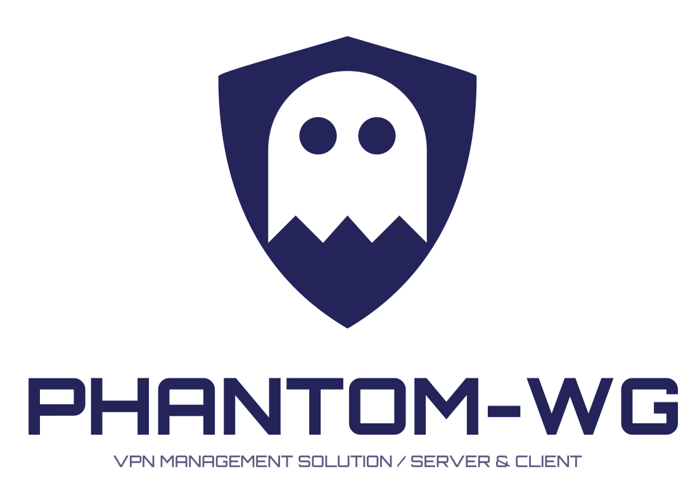
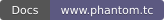
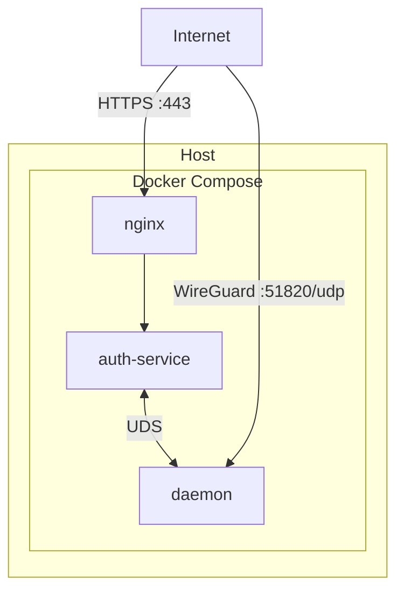
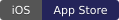

<div align="center">

<picture>
  <source media="(prefers-color-scheme: dark)" srcset="https://raw.githubusercontent.com/ARAS-Workspace/phantom-wg/press-kit/assets/phantom-vertical-master-stellar-silver.svg">
  <source media="(prefers-color-scheme: light)" srcset="https://raw.githubusercontent.com/ARAS-Workspace/phantom-wg/press-kit/assets/phantom-vertical-master-midnight-phantom.svg">
  
</picture>

[](LICENSE)
[](https://www.phantom.tc/docs)

</div>

## Phantom-WG Nedir?

***Phantom-WG***, kendi sunucu ortamınızda çalıştırabileceğiniz WireGuard altyapısına sahip bir VPN yönetim çözümüdür. Sunucu tarafında web kontrol paneli, istemci tarafında macOS ve iOS için imzalı uygulamalar sunar. Ayrı ve isteğe bağlı bir ön uç düğümü (**Phantom-Frontmatter**), bağlantıları TCP 443 üzerinden WebSocket Secure olarak taşır. Böylece istemciler, UDP'nin kısıtlandığı ağlardan da bağlantı sağlayabilir.

Phantom-WG kendi içinde alt ürünler barındırır. Bu ürünleri çalıştıkları yere göre sunucu tarafı ve istemci tarafı olarak gruplayabiliriz:

- **Sunucu tarafı:** Phantom-WG Modern, Phantom-Frontmatter
- **İstemci tarafı:** Phantom-WG Mac, Phantom-WG iOS

> [!IMPORTANT]
> **1.1.5 kurulumunuz mu var?** 2.0.0'a geçiş adımları [Taşıma Rehberi](https://github.com/ARAS-Workspace/phantom-wg/blob/press-kit/MIGRATION_TR.md)'nde belirtilmiştir. 2.0.0 mimari değişiklikler içerir. Eski otomatik güncelleme akışı bu sürüme geçiş için uygun değildir. [Taşıma Rehberi](https://github.com/ARAS-Workspace/phantom-wg/blob/press-kit/MIGRATION_TR.md) dokümanındaki adımların hassas bir şekilde takip edilmesi gereklidir.

---

## Phantom-WG Modern Kurulum ve Konfigürasyonu

Phantom-WG, Docker Compose ile yönetilen üç temel konteyner yapısını beraberinde bulundurur. Konteyner topolojisi diyagram üzerinde açıklanmaktadır.



### Gereksinimler

| Gereksinim      | Detay                                                                        |
|-----------------|------------------------------------------------------------------------------|
| İşletim sistemi | Linux, Kernel 5.15 veya üstü                                                 |
| Docker          | Docker Engine 27.0.1 veya üstü, Docker Compose eklentisi 2.27.2 veya üstü    |
| Python          | `python3` 3.9 veya üstü                                                      |
| TUN             | `/dev/net/tun`                                                               |
| Araçlar         | `bash`, klonla kurulum ve güncelleme için `git`, release arşivi için `unzip` |
| Kullanıcı       | `docker` grubunun bir üyesi ya da root                                       |

#### Kurulum Matrisi

Kurulum, sekiz dağıtımın güncel imajında [`Verify install matrix`](https://github.com/ARAS-Workspace/phantom-wg/actions/runs/42452212400) iş akışıyla sınanır. Her dağıtımda Docker kurulur, sunucu yeniden başlatılır ve projenin kendi araç setiyle `setup`, `up`, yetkili denetim, `down`, `hard-reset` adımları iki tur koşulur. Son koşu (8 Kasım 2026):

| Dağıtım        | Kernel | Docker Engine | Docker Compose |
|----------------|--------|---------------|----------------|
| Ubuntu 22.04   | 5.15   | 29.9.3        | 5.7.0          |
| Ubuntu 24.04   | 6.8    | 29.9.3        | 5.7.0          |
| Ubuntu 26.04   | 7.0    | 29.9.3        | 5.7.0          |
| Debian 12      | 6.1    | 29.9.3        | 5.7.0          |
| Debian 13      | 6.12   | 29.9.3        | 5.7.0          |
| Fedora 45      | 7.2    | 29.9.3        | 5.7.0          |
| Arch Linux     | 7.2    | 29.9.3        | 5.7.0          |
| AlmaLinux 10.2 | 6.12   | 29.9.3        | 5.7.0          |

### 1. İndirme

Phantom-WG Modern dağıtımını sunucunuza indirmek için iki farklı yolu tercih edebilirsiniz. Bu iki yol arasındaki fark, imajların nereden geldiği ve güncellemenin nasıl ele alındığıdır.

#### Git Klonu

Git klonu, dağıtımı GitHub deposunun `main` dalından alır. `main` dalı yayınlanan son sürümü taşır. Bu yöntem internet erişimi olan sunucular için uygundur.

```bash
git clone --depth 1 --branch main https://github.com/ARAS-Workspace/phantom-wg.git
cd phantom-wg
```

- `--depth 1`, `main` dalından yalnızca son commit'i alır. Güncelleme akışı ise klonu buradan ileri taşır.
- İmajlar kurulum sırasında registry üzerinden çekilir. Hangi imajın kullanılacağı dağıtım üzerinde sabittir. İmaj adresleri ve digest değerleri [`tools/compose/registry.yml`](tools/compose/registry.yml) dosyasındadır.
- Yeni sürüm aynı dizinde `./tools/prod.sh update` ile alınır.
- Gereken araç: `git`.

#### Release Arşivi

Release arşivi imajları içinde taşır ve registry tarafına ulaşmadan imajlar kurulur. Bu yöntem çevrimdışı kurulumlar için ideal bir çözümdür ancak yerel güncelleme desteğini (git) varsayılan olarak içerisinde barındırmaz. Güncelleme sürecinin operatör tarafından manuel olarak ele alınması gerekir.

[Releases](https://github.com/ARAS-Workspace/phantom-wg/releases) sayfasından mimarinize uygun dosyayı indirin:

```bash
uname -m                                      # x86_64: amd64, aarch64: arm64
unzip phantom-wg-modern-v<sürüm>-amd64.zip    # ya da -arm64
cd phantom-wg-modern
```

- Arşiv her mimari için ayrıdır: `amd64` ve `arm64`.
- İmajlar arşivin `images/` dizinindedir. `setup` onları sağlama toplamlarını denetleyerek yükler.
- `update` komutu bu kurulumda durur. Yeni sürüm kendi arşivinden kurulur.
- Gereken araç: `unzip`.

### 2. Kurulum

```bash
./tools/prod.sh gates    # host'un sağladıklarını raporlar
./tools/prod.sh setup
```

`setup` eksik olanı şu sırayla oluşturur:

1. `.env`, `.env.daemon`, `.env.auth-service` ve `docker-compose.override.yml` (her biri kendi `.example` dosyasından)
2. WireGuard sunucu anahtar çifti
3. Auth-service anahtarları, `admin` hesabı ve veritabanı
4. Self-signed TLS sertifikası
5. Adres havuzu

İstemciler adreslerini varsayılan olarak `10.8.0.0/24` havuzundan alır. Başka bir subnet yalnızca ilk kurulumda verilir:

```bash
./tools/prod.sh setup --terazi-ipv4-subnet=10.9.0.0/24
```

**Terazi**, Phantom-WG üzerinde adres havuzunu ele alan mimarinin kendisidir. IPv4 ve IPv6 adreslerini aynı sıra numarası (index) üzerinden eşler. Bu yüzden tek bir IPv4 subnet'i iki havuzu da belirler ve her istemci iki adresini birlikte alır.

- Havuz kurulumda oluşturulur ve baştan doludur. İstemci eklemek ilk boş yuvayı işaretler, istemciyi iptal etmek yuvayı serbest bırakır.
- `/24` bir subnet 253 istemci taşır. Ağ, yayın ve sunucu adresleri ayrılmıştır.
- Subnet özel (RFC 1918) bir aralıktan, `/16` ile `/30` arasında seçilir. Kurulumdan sonra yalnızca prefix uzunluğu kontrol panelinden değiştirilebilir. Ardından istemci yapılandırmalarının yeniden dışa aktarılması gerekir.

### 3. Endpoint

`.env.daemon` dosyasına sunucunun dışarıya açılan IP adresini yazın:

```bash
nano .env.daemon
```

```ini
WIREGUARD_ENDPOINT_V4=203.0.113.1
WIREGUARD_ENDPOINT_V6=2001:db8::1
```

Bu adresler kontrol panelinin dışa aktardığı istemci yapılandırmalarına girer. Daemon onları açılışta okur, bu yüzden `up` komutundan önce yazılır.

### 4. Başlatma

```bash
./tools/prod.sh up
```

| Erişim         | Değer                                                   |
|----------------|---------------------------------------------------------|
| Kontrol paneli | `https://<sunucu-ip>`                                   |
| WireGuard      | UDP port `51820`                                        |
| Kullanıcı adı  | `admin`                                                 |
| Şifre          | `cat container-data/secrets/production/.admin_password` |

### Konfigürasyon

**Konteyner yapısına özgü ayarlar.** Konteyner yapısına özgü bir ayar değiştirilecekse `docker-compose.yml` değil, `docker-compose.override.yml` düzenlenir. `docker-compose.yml` her sürümle birlikte gelir ve yerel değişiklik taşıyorsa `update` durur. `docker-compose.override.yml` ise git tarafından izlenmez ve güncelleme ona dokunmaz. Stack üzerinde konteyner yapısına özgü değişikliklerin uygulanması gerekiyorsa tavsiye edilen yöntem budur.

**Let's Encrypt.** Varsayılan sertifika self-signed'dır. Alan adınızın A kaydı sunucuyu gösteriyorsa ve 80 portu erişilebilirse Let's Encrypt sertifikası alınabilir.

```bash
./tools/prod.sh certbot <domain>
./tools/prod.sh restart nginx
```

Aynı iki komut sertifikayı yeniler. Aynı komut zinciri cron üzerinden de çalıştırılmaya uygundur.

**Cloudflare modu.** Stack, Cloudflare proxy arkasında çalışabilir. Bu modda kontrol paneline yalnızca Cloudflare üzerinden ulaşılır. Kurulum beş aşamadır.

1. **API Token**

   - Cloudflare panelinde **My Profile** > **API Tokens** sayfasını açın ve **Create Token** seçin.
   - Şablon seçmeden başlayın ve aşağıdaki dört izni ekleyin.
   - Zone kaynağı olarak yalnızca bu modda kullanacağınız zone'u seçin.
   - **Continue to summary** ve ardından **Create Token** seçin.
   - Token değeri yalnızca bir kez gösterilir. Bu değer üçüncü aşamada `.env.cf` dosyasına yazılır.

   | İzin                                 | Araç bu izinle ne yapar                                    |
   |--------------------------------------|------------------------------------------------------------|
   | `Zone - Zone - Read`                 | Zone'u adından bulur.                                      |
   | `Zone - Zone Settings - Read`        | SSL/TLS modunu ve Authenticated Origin Pulls ayarını okur. |
   | `Zone - SSL and Certificates - Edit` | Origin CA sertifikasını alır. Mod kapatılırken iptal eder. |
   | `Zone - SSL and Certificates - Read` | İptal isteği reddedilirse sertifikanın durumunu okur.      |

2. **Zone Ayarları**

   - **SSL/TLS** > **Overview** sayfasında şifreleme modunu **Full (strict)** olarak seçin.
   - **SSL/TLS** > **Origin Server** sayfasında **Authenticated Origin Pulls** sekmesini açın. **Global** bölümündeki seçeneği **On** konumuna getirin.
   - Kontrol paneli için kullanacağınız alan adının DNS kaydı sunucunun IP adresini göstermelidir. Kaydın proxy durumu **Proxied** olmalıdır.

3. **`.env.cf` Dosyası**

   ```bash
   ./tools/prod.sh cloudflare on
   nano .env.cf
   ```

   - İlk `cloudflare on` çağrısı `.env.cf` dosyasını `.env.cf.example` dosyasından yazar ve durur.
   - `CF_API_TOKEN` satırına token değerini yazın.
   - `CF_ZONE` satırına zone adını yazın. Örnek: `example.com`.
   - `CF_HOSTNAMES` sertifikanın kapsayacağı adları virgülle ayrılmış olarak taşır. Boş bırakılırsa zone ve `*.<zone>` kullanılır. Kontrol panelinin alan adı bu adlar arasında olmalıdır.
   - Dosya bu sunucuya aittir. Git onu izlemez. Araç dosya iznini 600 olarak tutar.

4. **Modu Açma**

   ```bash
   ./tools/prod.sh cloudflare on
   ```

   - Araç zone'un SSL/TLS modunu ve Authenticated Origin Pulls ayarını okur. Mod Full (strict) değilse ya da Authenticated Origin Pulls kapalıysa durur.
   - Özel anahtarı sunucuda üretir ve bu anahtar için Cloudflare'den 15 yıl (5475 gün) geçerli bir Origin CA sertifikası alır.
   - Cloudflare'in origin pull CA sertifikasını ve adres listesini indirir.
   - nginx ayarlarını ve firewall kurallarını `container-data/cloudflare/` dizinine yazar.
   - Modun girdilerini `docker-compose.override.yml` dosyasına ekler. Önceki dosya `docker-compose.override.yml.bak` adıyla kalır.

5. **Uygulama**

   ```bash
   ./tools/prod.sh up
   ./tools/prod.sh cloudflare    # modun durumunu gösterir
   ```

   - `up` nginx'i yeni ayarlarla yeniden oluşturur.
   - 443 portu Cloudflare adresleri dışından gelen bağlantıları düşürür ve nginx Cloudflare'in origin pull sertifikasını ister.
   - Kontrol paneline `https://<sunucu-ip>` adresinden değil, alan adınız üzerinden ulaşılır.
   - Loglar ve audit kaydı ziyaretçinin gerçek IP adresini taşır.

Modun kapatılması ve adres listesinin yenilenmesi `SETUP` dosyasının Cloudflare bölümündedir.

### Güncelleme

```bash
./tools/prod.sh update
```

Git klonu ile kurulan sunucu son sürümü çeker, imajları eşitler ve servisleri yeniden oluşturur. Env dosyaları ve `docker-compose.override.yml` korunur.

### Ayrıntılar

| Kaynak                 | İçerik                                                                      |
|------------------------|-----------------------------------------------------------------------------|
| [SETUP](SETUP)         | Kurulum rehberi: komutlar, imaj kaynakları, veri dizinleri, Cloudflare modu |
| [UPDATE](UPDATE)       | Güncelleme, önceki sürüme dönüş, hard reset                                 |
| [CHANGELOG](CHANGELOG) | Sürüm değişiklikleri                                                        |
| `./tools/prod.sh help` | Bütün komutlar                                                              |

---

## Phantom-Frontmatter Kurulum ve Konfigürasyonu

Phantom-Frontmatter, Phantom-WG Modern sunucusunun önüne yerleştirilen isteğe bağlı bir taşıma katmanıdır ve ayrı bir sunucuya kurulur. İstemci bağlantılarını TCP 443 üzerinde TLS ile karşılar ve trafiği Phantom-WG Modern sunucusuna iletir.


### Gereksinimler

| Gereksinim      | Detay                                                   |
|-----------------|---------------------------------------------------------|
| İşletim sistemi | Debian 12 / 13, Ubuntu 22.04 / 24.04 / 26.04            |
| Erişim          | Root (sudo)                                             |
| Backend         | Erişilebilir bir Phantom-WG Modern sunucusu (UDP 51820) |

### 1. Kurulum

Güncel sürüm: [frontmatter-v1.0.2](https://github.com/ARAS-Workspace/phantom-wg/releases/tag/frontmatter-v1.0.2)

```bash
# Gereken paketleri kurun
sudo apt-get update
sudo apt-get install -y wget unzip jq

# Paketi indirin ve kurun
wget https://github.com/ARAS-Workspace/phantom-wg/releases/download/frontmatter-v1.0.2/phantom-wg-frontmatter-v1.0.2.zip
unzip phantom-wg-frontmatter-v1.0.2.zip
cd phantom-wg-frontmatter-v1.0.2
sudo ./frontmatter-install.sh
```

### 2. Yapılandırma

```bash
# Backend sunucuyu tanımlayın (IPv4 ya da IPv6)
sudo frontmatter-api setup init backend=<BACKEND_IP[:PORT]>

# Veri yolunu başlatın
sudo frontmatter-api ghost start

# Durumu doğrulayın
sudo frontmatter-api ghost status
```

### 3. İstemci Bloğu

```bash
sudo frontmatter-api ghost client_config | jq -r '.data.wstunnel_block'
```

Çıktı, istemci yapılandırmasına eklenecek `[Wstunnel]` bloğunu verir. Bloğu kontrol panelinden aldığınız istemci yapılandırmasına ekleyin ve `<FRONTMATTER-PUBLIC-IP>` yerine bu sunucunun adresini yazın.

```ini
# "frontmatter-api ghost client_config" komutundan alınan blok
[Wstunnel]
Url = ...
Secret = ...
Tunnel = ...

# Kontrol panelinden alınan WireGuard istemci yapılandırması
[Interface]
PrivateKey = ...
Address = ...
DNS = ...
MTU = ...

[Peer]
PublicKey = ...
PresharedKey = ...
AllowedIPs = ...
Endpoint = ...
PersistentKeepalive = ...
```

wstunnel'i kendi başına çalıştıran istemciler için bağlantı komutu şu şekilde alınır:

```bash
sudo frontmatter-api ghost client_command | jq -r '.data.command'
```

Çıktıdaki komutu çalıştırmadan önce `<FRONTMATTER-PUBLIC-IP>` yerine bu sunucunun adresini yazın.

### Let's Encrypt (Opsiyonel)

```bash
sudo frontmatter-api ghost stop
sudo frontmatter-certbot front.example.com
sudo frontmatter-api ghost start
```

### Güncelleme

Kurulu bir sunucu yerinde güncellenir. Yeni sürümün arşivi hedef sunucuya indirilir ve açılır. Ardından güncelleme betiği çalıştırılır. Veritabanı durumu, sertifika materyali ve gizli anahtar güncelleme sürecinde korunur. `frontmatter-install.sh` yalnızca ilk kurulum içindir.

```bash
sudo ./frontmatter-update.sh
```

### Ayrıntılar

| Kaynak          | Bağlantı                                                                                         |
|-----------------|--------------------------------------------------------------------------------------------------|
| Kurulum Rehberi | [SETUP](https://github.com/ARAS-Workspace/phantom-wg/blob/frontmatter/SETUP)                     |
| Mimari          | [ARCHITECTURE](https://github.com/ARAS-Workspace/phantom-wg/blob/frontmatter/ARCHITECTURE)       |
| Mimari (TR)     | [ARCHITECTURE_TR](https://github.com/ARAS-Workspace/phantom-wg/blob/frontmatter/ARCHITECTURE_TR) |
| Kaynak Kod      | [GitHub](https://github.com/ARAS-Workspace/phantom-wg/tree/frontmatter)                          |

---

## İstemci Uygulamaları

| Platform | İndirme                                                                                                                                                                                                             |
|----------|---------------------------------------------------------------------------------------------------------------------------------------------------------------------------------------------------------------------|
| iOS      | [](https://apps.apple.com/app/phantom-wg/id6812090582)                                      |
| macOS    | [](https://github.com/ARAS-Workspace/phantom-wg/releases/tag/mac-v2.1.3)                  |

---

## Ticari Marka Bildirimi

WireGuard® Jason A. Donenfeld'in tescilli ticari markasıdır.

Bu proje; Jason A. Donenfeld, ZX2C4 veya Edge Security ile herhangi bir şekilde bağlantılı, ortaklı, yetkili veya onaylı değildir.

---

## Lisans

Telif Hakkı (c) 2025 Rıza Emre ARAS

[AGPL-3.0](LICENSE) lisansı altında lisanslanmıştır. Bağımlılık lisansları için [THIRD_PARTY_LICENSES](THIRD_PARTY_LICENSES) dosyasına bakın.
