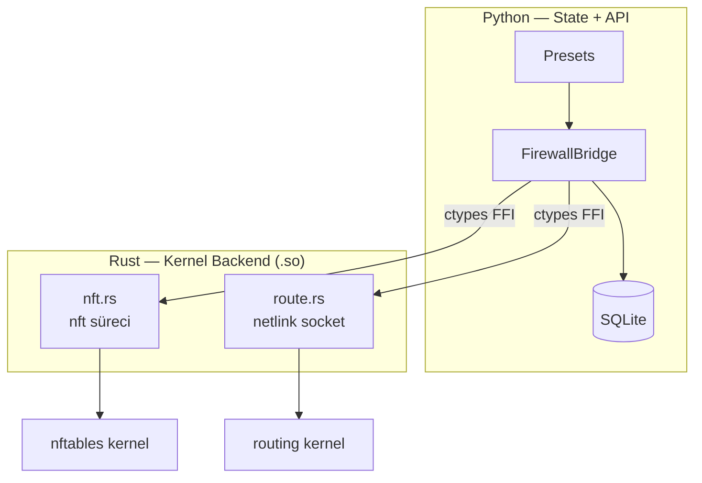
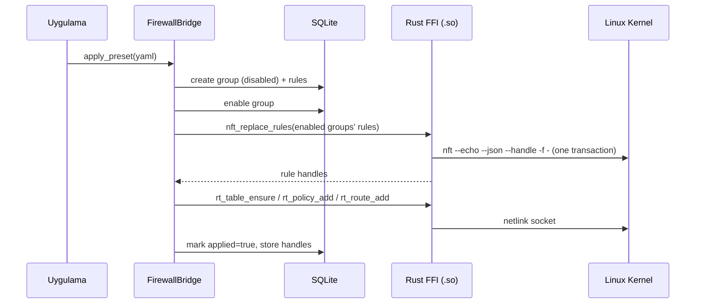
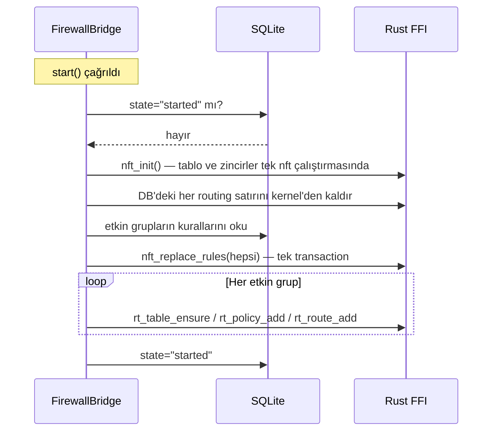
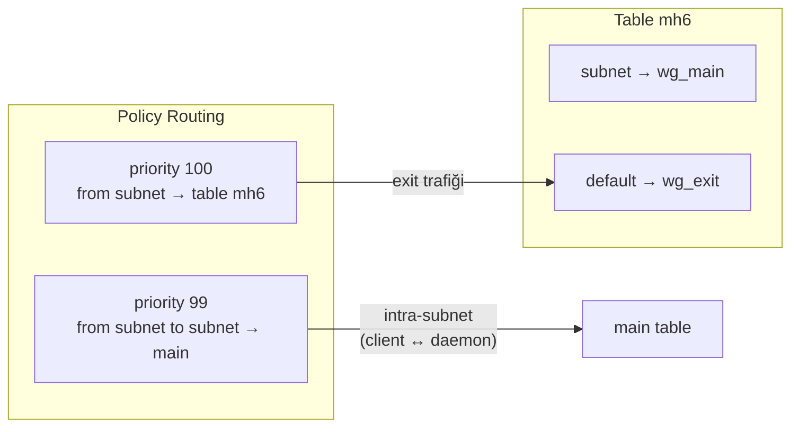

# firewall-bridge

Linux firewall yöneticisi — nftables + policy routing, SQLite state, YAML preset'ler.

- Rust backend kernel ile netlink socket ve nft programı üzerinden konuşur.
- Python katmanı state machine, DB persistence ve preset sistemi sağlar. 

## İndirme

Her sürüm etiketlenmiş bir release'tir. Birini seç, asset'lerini al:

```
https://github.com/ARAS-Workspace/phantom-wg/releases/download/vendor-firewall-bridge-v<X.Y.Z>/linux-amd64.zip
https://github.com/ARAS-Workspace/phantom-wg/releases/download/vendor-firewall-bridge-v<X.Y.Z>/linux-arm64.zip
```

Her zip şu yapıya açılır:

```
firewall_bridge/
├── __init__.py
├── _ffi.py
├── bridge.py
├── db.py
├── models.py
├── presets.py
├── schema.py
├── types.py
├── schemas/
│   └── schema.sql
├── libfirewall_bridge_linux.so
├── libfirewall_bridge_linux.so.sha256
├── firewall_bridge_linux.h
├── VERSION
├── LICENSE
└── THIRD_PARTY_LICENSES
```

Release'ler [https://github.com/ARAS-Workspace/phantom-wg/releases](https://github.com/ARAS-Workspace/phantom-wg/releases) adresinde listelenir; bu bileşenin etiketleri
`vendor-firewall-bridge-` önekini taşır. Bu branch'teki sürüm
[`firewall_bridge/__init__.py`](firewall_bridge/__init__.py) içindedir
(`__version__`).

## Gereksinimler

- glibc 2.39 veya daha yeni bir sürüm
- Bir Linux çekirdeği: 5.15, 6.1 ve 6.12 test edilir, bkz. [Çekirdek Uyumluluğu](#çekirdek-uyumluluğu)
- `nftables` paketindeki `nft` programı (`/usr/sbin/nft`)
- Alt süreçlere aktarılabilen `CAP_NET_ADMIN` yetkisi
- Varsayılan davranışında bırakılmış `SIGCHLD` sinyali
- Yazılabilir bir `/etc/iproute2` dizini

**glibc.** Yayınlanan `.so` dosyası `rust:<sürüm>-trixie` imajında (glibc 2.41) derlenir ve
`GLIBC_2.39` sürümünü gerektirir. Bu nedenle daha eski bir glibc'ye sahip sistemler, örneğin
Debian bookworm (glibc 2.36), kütüphaneyi yükleyemez. Buradaki glibc, kütüphaneyi yükleyen
sistemin ya da konteynerin glibc'sidir, örneğin daemon konteynerinin; çekirdek ise ana makinenin
çekirdeğidir. Aşağıdaki çekirdek matrisinde kütüphane, Ubuntu 22.04 ve Debian 12 ana
makinelerinde Debian trixie konteynerlerinde çalışır.

**nft programı.** Köprü, nftables kurallarını varsayılan olarak `/usr/sbin/nft` programıyla
uygular. Program başka bir konumdaysa bu konum `FIREWALL_BRIDGE_NFT_PATH` ortam değişkeniyle
belirtilir; değişken yalnızca mutlak yol kabul eder.

**CAP_NET_ADMIN.** nft ayrı bir süreç olarak çalıştığı için, yetkinin köprüyü yükleyen süreçten
bu alt sürece aktarılabilmesi gerekir. Bunun için süreç ya root olarak çalışmalı ya da
`CAP_NET_ADMIN` yetkisini ambient yetki olarak taşımalıdır. Yalnızca yükleyen süreçte geçerli
olan bir yetki, örneğin yorumlayıcıya `setcap` ile verilmiş bir yetki, nft'ye aktarılmaz.
Phantom-WG'nin daemon konteyneri root olarak ve `cap_add: [NET_ADMIN, NET_RAW]` ayarıyla
çalışır.

**SIGCHLD.** Köprü, başlattığı her nft sürecinin sona ermesini çağrı dönmeden önce bekler; süreç
başarıyla bitse de, hata verse de, bir sinyalle sonlandırılsa da bu böyledir. Böylece hiçbir
süreç zombi olarak kalmaz; köprüyü yükleyen süreç init'i olmayan bir konteynerde PID 1 olarak
çalıştığında da bu geçerlidir. `SIGCHLD` sinyali `SIG_IGN` olarak ayarlanırsa çekirdek alt
süreci kendisi toplar; bu durumda komut uygulanmış olsa bile çağrı hata döndürür.

**/etc/iproute2.** Köprü, yönlendirme tablolarının adlarını kendi dosyasına,
`/etc/iproute2/rt_tables.d/phantom.conf` dosyasına, her tablo için bir `<id> <ad>` satırı olarak
yazar; dosya ya da dizini yoksa oluşturur. `/etc/iproute2/rt_tables` dosyasına dokunulmaz. `ip`
adları bu dosyadan okur; böylece `ip rule` ve `ip route` köprünün tablolarını adlarıyla gösterir.

## Çekirdek Uyumluluğu

Köprü, çalışan çekirdekle nft ve bir netlink soketi üzerinden çalışır: çekirdek her zaman ana
makinenindir, glibc ve nft ise kütüphaneyi yükleyen sistemin ya da konteynerindir.
[`kernel-matrix-firewall-bridge.yml`](.github/workflows/kernel-matrix-firewall-bridge.yml)
tablodaki her sürümü KVM altında, ilk bulut imajından ve o imajın çekirdeğiyle açar ve test
workflow'unun adımlarını içinde koşturur: dev konteynerinde Rust testleri, Python unit testleri ve
üç E2E aşaması (topology, rules, rules-caps). Her ana makinede konteynerler nftables 1.1.3 ile
Debian trixie'dir (`rust:1.99.1-trixie`, `debian:trixie-slim`), Docker CE ise 29.8.0'dır.
Workflow, `dev/firewall-bridge` dalına yapılan her push'ta çalışır.

| Ana makine            | Çekirdek              | Rust testleri       | Python unit testleri | E2E aşamaları | Durum         |
|-----------------------|-----------------------|---------------------|----------------------|---------------|---------------|
| Ubuntu 22.04 (GA)     | `5.15.0-25-generic`   | 84 geçti            | 312 geçti            | 3/3 geçti     | matriste      |
| Debian 12.0           | `6.1.0-9-amd64`       | 84 geçti            | 312 geçti            | 3/3 geçti     | matriste      |
| Debian 13.0           | `6.12.38+deb13-amd64` | 84 geçti            | 312 geçti            | 3/3 geçti     | matriste      |
| Debian 11.0           | `5.10.0-8-amd64`      | 82 geçti, 2 düştü   | 312 geçti            | koşmadı       | çıkarıldı     |

İlk üç satır, `aae7d5cb` üzerindeki
[41551902856](https://github.com/ARAS-Workspace/phantom-wg/actions/runs/41551902856) koşusudur
(2026-11-03); koşunun özeti her konuğun çekirdeğini, her adımın çıkış kodunu ve süresini ve test
sonuçlarını listeler. Debian 11 satırı, `6346d1b8` üzerindeki
[41542386316](https://github.com/ARAS-Workspace/phantom-wg/actions/runs/41542386316) koşusudur
(2026-11-02).

**Test edilen çekirdekler.** Her sürüm ilk imajının çekirdeğiyle test edilir ve matristeki en
düşük çekirdek 5.15'tir. Bu sürümlerin sonraki çekirdekleri, örneğin Ubuntu 22.04'ün HWE
çekirdekleri, ve yukarıdaki üç çekirdeğin arasındaki ve sonrasındaki çekirdekler matriste yoktur.

**nft'nin iletileri çekirdeğe bağlıdır.** Çekirdek, başka bir tanımla zaten var olan bir zinciri
reddettiğinde aynı nft 1.1.3, 6.12'de `Error: Chain "output" already exists ...`, 5.10, 5.15 ve
6.1'de `Error: Could not process rule: File exists` iletisini verir. Köprü nft'nin iletisini hata
metni olarak döndürür; bu nedenle çağıran taraf ikisinden birini görür.

**Debian 11 (5.10), matristen çıkarıldı.** 41542386316 koşusunda:

- `kernel_nft_builds_what_nft_builds_from_text` düştü: 5.10'da nft'nin eklenen bir kural için
  `--echo --json --handle` çıktısında handle yoktur. Test referans kuralını bu çıktıdan alır;
  köprünün aynı kural için yaptığı çağrı bir handle döndürdü.
- `kernel_nft_ensure_table_is_all_or_nothing` yukarıdaki ileti yüzünden düştü. `d4d4622e`'den
  bu yana test bu iletiyi kabul eder; testin diğer denetimleri 5.10'da koşmadı.
- E2E aşamaları koşmadı: ana makinedeki E2E runner Python 3.10 gerektirir (compose-bridge
  `dataclass(slots=True)` kullanır), Debian 11'de ise Python 3.9 vardır.

## Mimari



## Katmanlar

| Katman       | Sorumluluk                                       |
|--------------|--------------------------------------------------|
| `bridge.py`  | State machine, DB CRUD, FFI dispatch             |
| `presets.py` | YAML parse, group create, batch rule apply       |
| `db.py`      | SQLite persistence, migration, WAL mode          |
| `_ffi.py`    | cdylib load, ctypes binding                      |
| `nft.rs`     | nftables chain/rule CRUD — nft süreci            |
| `route.rs`   | Policy routing + route table — netlink socket    |

## Veri Akışı



## Crash Recovery



DB truth kaynağıdır. Kernel state her start'ta DB'den yeniden oluşturulur. Crash sonrası daemon restart yeterlidir.
Kernel bir kuralı reddederse start uyguladığını geri kaldırır, köprü durmuş kalır ve hata yükseltilir.

## Preset Yapısı

```yaml
name: multihop-exit-v6
priority: 80
metadata:
  description: Forward IPv6 traffic wg_main to wg_exit

table:
  - ensure: {id: 201, name: mh6, family: 10}
  - policy: {from: "fd00:10:1::/64", to: "fd00:10:1::/64", table: main, priority: 99, family: 10}
  - policy: {from: "fd00:10:1::/64", table: mh6, priority: 100, family: 10}
  - route:  {destination: default, device: wg_exit, table: mh6, family: 10}

rules:
  - chain: forward
    action: accept
    family: 10
    in_iface: wg_main
    out_iface: wg_exit
  - chain: postrouting
    action: masquerade
    family: 10
    source: "fd00:10:1::/64"
    out_iface: wg_exit
```

`family: 10` = AF_INET6, `family: 2` (default) = AF_INET.

## Dual-Stack IPv6



Priority 99 kuralı aynı subnet içindeki trafiği (client reply) main table'a yönlendirir. Bu olmadan reply paketleri exit tüneline gider.

## Dizin Yapısı

```
firewall-bridge/
├── src/                    # Rust — kernel backend
│   ├── lib.rs              # FFI export, nft context
│   ├── nft.rs              # nftables chain/rule ops
│   ├── route.rs            # netlink policy routing
│   └── error.rs            # error codes
├── include/
│   └── firewall_bridge_linux.h  # C FFI header
├── firewall_bridge/        # Python — state + API
│   ├── __init__.py         # public API, __version__
│   ├── bridge.py           # FirewallBridge state machine
│   ├── db.py               # SQLite persistence + migration
│   ├── models.py           # Group, FirewallRule, RoutingRule
│   ├── presets.py          # YAML preset applicator
│   ├── schema.py           # preset validation
│   ├── _ffi.py             # ctypes bindings
│   ├── types.py            # error types
│   └── schemas/schema.sql  # DB schema
├── tests/                  # Unit tests (Docker SDK runner)
├── e2e_tests/              # E2E tests (compose-bridge)
├── dev/                    # Local dev tools
└── .github/
    ├── workflows/          # CI/CD
    └── scripts/publish.sh  # release publish trigger
```

## Geliştirme

```bash
# Rust testleri: birim testleri ve dev/cargo.sh'nin başlattığı ayrıcalıklı
# dev konteynerini gerektiren çekirdek testleri (nft, netlink)
dev/build.sh && dev/cargo.sh test --lib

# Dev konteynerinde clippy, her uyarı hata sayılır
dev/clippy.sh

# Python unit testleri
python tests/runner.py

# E2E testleri (compose-bridge gerekli)
bash fetch_compose_bridge.sh
python e2e_tests/runner.py

# Publish (workflow_dispatch tetikler)
.github/scripts/publish.sh
```

## Versiyon

Tek kaynak: `firewall_bridge/__init__.py` → `__version__`

CI/CD, publish workflow ve VERSION dosyası bu değerden türetilir.

## Paket Doğrulama

Zip kendi hash'ini taşır: `libfirewall_bridge_linux.so.sha256`, tarif ettiği kütüphanenin yanında
durur. Paket, açıldıktan sonra hiçbir şey indirmeden kontrol edilebilir.

```bash
unzip -q linux-amd64.zip
cd firewall_bridge && sha256sum -c libfirewall_bridge_linux.so.sha256
```

Zip'in kendisini ise geldiği release doğrular. GitHub her asset için bir
digest tutar; `gh` bunu yazdırır:

```bash
gh release view vendor-firewall-bridge-v<X.Y.Z> \
  --repo ARAS-Workspace/phantom-wg --json assets \
  --jq '.assets[] | "\(.name) \(.digest)"'
```

## Lisans

AGPL-3.0 — [LICENSE](LICENSE) | [THIRD_PARTY_LICENSES](THIRD_PARTY_LICENSES)
