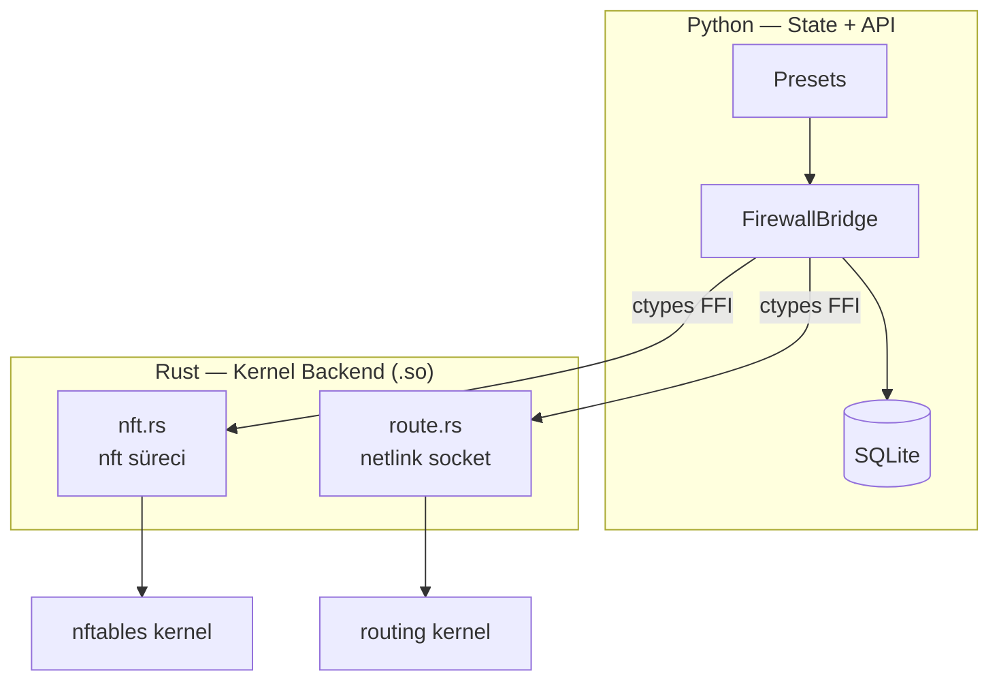
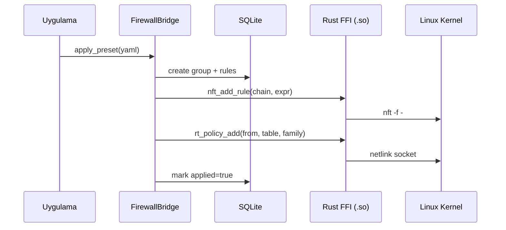
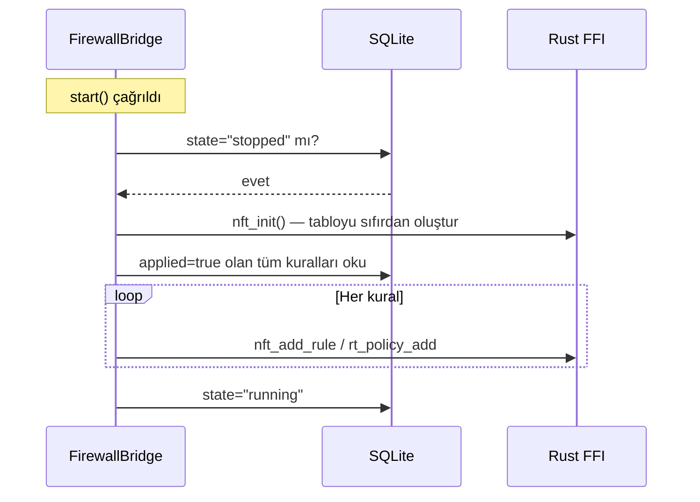
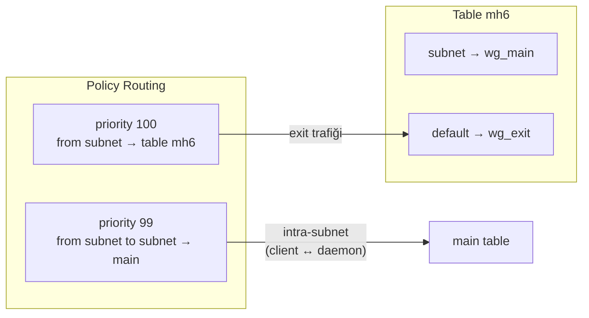

# firewall-bridge

Linux firewall yöneticisi — nftables + policy routing, SQLite state, YAML preset'ler.

- Rust backend kernel ile netlink socket ve nft programı üzerinden konuşur.
- Python katmanı state machine, DB persistence ve preset sistemi sağlar. 

## İndirme

Her sürüm etiketlenmiş bir release'tir. Birini seç, asset'lerini al:

```
https://github.com/ARAS-Workspace/phantom-wg/releases/download/vendor-firewall-bridge-v<X.Y.Z>/linux-amd64.zip
https://github.com/ARAS-Workspace/phantom-wg/releases/download/vendor-firewall-bridge-v<X.Y.Z>/linux-arm64.zip
```

Her zip şu yapıya açılır:

```
firewall_bridge/
├── __init__.py
├── _ffi.py
├── bridge.py
├── db.py
├── models.py
├── presets.py
├── schema.py
├── types.py
├── schemas/
│   └── schema.sql
├── libfirewall_bridge_linux.so
├── libfirewall_bridge_linux.so.sha256
├── firewall_bridge_linux.h
├── VERSION
├── LICENSE
└── THIRD_PARTY_LICENSES
```

Release'ler [https://github.com/ARAS-Workspace/phantom-wg/releases](https://github.com/ARAS-Workspace/phantom-wg/releases) adresinde listelenir; bu bileşenin etiketleri
`vendor-firewall-bridge-` önekini taşır. Bu branch'teki sürüm
[`firewall_bridge/__init__.py`](firewall_bridge/__init__.py) içindedir
(`__version__`).

## Mimari



## Katmanlar

| Katman       | Sorumluluk                                       |
|--------------|--------------------------------------------------|
| `bridge.py`  | State machine, DB CRUD, FFI dispatch             |
| `presets.py` | YAML parse, group create, batch rule apply       |
| `db.py`      | SQLite persistence, migration, WAL mode          |
| `_ffi.py`    | cdylib load, ctypes binding                      |
| `nft.rs`     | nftables chain/rule CRUD — nft süreci            |
| `route.rs`   | Policy routing + route table — netlink socket    |

## Veri Akışı



## Crash Recovery



DB truth kaynağıdır. Kernel state her start'ta DB'den yeniden oluşturulur. Crash sonrası daemon restart yeterlidir.

## Preset Yapısı

```yaml
name: multihop-exit-v6
priority: 80
metadata:
  description: Forward IPv6 traffic wg_main to wg_exit

table:
  - ensure: {id: 201, name: mh6, family: 10}
  - policy: {from: "fd00:10:1::/64", to: "fd00:10:1::/64", table: main, priority: 99, family: 10}
  - policy: {from: "fd00:10:1::/64", table: mh6, priority: 100, family: 10}
  - route:  {destination: default, device: wg_exit, table: mh6, family: 10}

rules:
  - chain: forward
    action: accept
    family: 10
    in_iface: wg_main
    out_iface: wg_exit
  - chain: postrouting
    action: masquerade
    family: 10
    source: "fd00:10:1::/64"
    out_iface: wg_exit
```

`family: 10` = AF_INET6, `family: 2` (default) = AF_INET.

## Dual-Stack IPv6



Priority 99 kuralı aynı subnet içindeki trafiği (client reply) main table'a yönlendirir. Bu olmadan reply paketleri exit tüneline gider.

## Dizin Yapısı

```
firewall-bridge/
├── src/                    # Rust — kernel backend
│   ├── lib.rs              # FFI export, nft context
│   ├── nft.rs              # nftables chain/rule ops
│   ├── route.rs            # netlink policy routing
│   └── error.rs            # error codes
├── include/
│   └── firewall_bridge_linux.h  # C FFI header
├── firewall_bridge/        # Python — state + API
│   ├── __init__.py         # public API, __version__
│   ├── bridge.py           # FirewallBridge state machine
│   ├── db.py               # SQLite persistence + migration
│   ├── models.py           # Group, FirewallRule, RoutingRule
│   ├── presets.py          # YAML preset applicator
│   ├── schema.py           # preset validation
│   ├── _ffi.py             # ctypes bindings
│   ├── types.py            # error types
│   └── schemas/schema.sql  # DB schema
├── tests/                  # Unit tests (Docker SDK runner)
├── e2e_tests/              # E2E tests (compose-bridge)
├── dev/                    # Local dev tools
└── .github/
    ├── workflows/          # CI/CD
    └── scripts/publish.sh  # release publish trigger
```

## Geliştirme

```bash
# Rust testleri
dev/build.sh && dev/cargo.sh test --lib

# Python unit testleri
python tests/runner.py

# E2E testleri (compose-bridge gerekli)
bash fetch_compose_bridge.sh
python e2e_tests/runner.py

# Publish (workflow_dispatch tetikler)
.github/scripts/publish.sh
```

## Versiyon

Tek kaynak: `firewall_bridge/__init__.py` → `__version__`

CI/CD, publish workflow ve VERSION dosyası bu değerden türetilir.

## Paket Doğrulama

Zip kendi hash'ini taşır: `libfirewall_bridge_linux.so.sha256`, tarif ettiği kütüphanenin yanında
durur. Paket, açıldıktan sonra hiçbir şey indirmeden kontrol edilebilir.

```bash
unzip -q linux-amd64.zip
cd firewall_bridge && sha256sum -c libfirewall_bridge_linux.so.sha256
```

Zip'in kendisini ise geldiği release doğrular. GitHub her asset için bir
digest tutar; `gh` bunu yazdırır:

```bash
gh release view vendor-firewall-bridge-v<X.Y.Z> \
  --repo ARAS-Workspace/phantom-wg --json assets \
  --jq '.assets[] | "\(.name) \(.digest)"'
```

## Lisans

AGPL-3.0 — [LICENSE](LICENSE) | [THIRD_PARTY_LICENSES](THIRD_PARTY_LICENSES)
