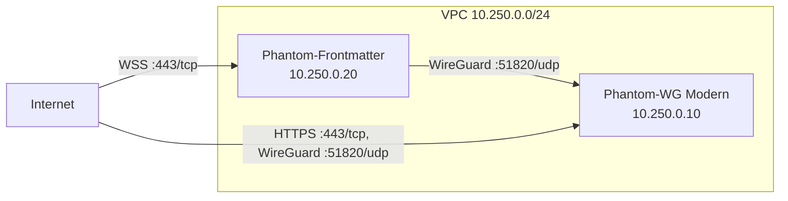

# Phantom-WG on AWS EC2

This directory holds an Ansible Playbook that sets up the basic server topology of Phantom-WG on AWS EC2. The playbook runs with one command and sets up two nodes. Phantom-WG Modern is installed on one of the nodes, Phantom-Frontmatter on the other. The run ends with a guide that tells how to use the setup.



Phantom-Frontmatter reaches the Phantom-WG Modern server inside the VPC, over its private address. The transport layer is optional. For this reason the WireGuard port of the Phantom-WG Modern server is open to the internet as well.

## What It Sets Up

All of the resources on the AWS side are set up in a single CloudFormation stack (a group of resources created together and deleted together).

| Resource                 | Detail                                                              |
|--------------------------|---------------------------------------------------------------------|
| VPC                      | `10.250.0.0/24` and an IPv6 block given by Amazon                   |
| Subnet                   | One subnet. The whole IPv4 block, the first `/64` of the IPv6 block |
| Internet gateway         | The default route for IPv4 and IPv6                                 |
| Modern security group    | `443/tcp`, `80/tcp`, `51820/udp`, `22/tcp`                          |
| Front security group     | `443/tcp`, `80/tcp`, `22/tcp`                                       |
| Key pair                 | The public key of the SSH key pair the run generates                |
| Phantom-WG Modern node   | Debian 13 amd64, `t3.small`, 20 GiB `gp3` disk, `10.250.0.10`       |
| Phantom-Frontmatter node | Debian 13 amd64, `t3.micro`, `10.250.0.20`                          |
| Elastic IP               | Two static public IPv4 addresses, one for each node                 |

Every rule in the security groups is open to every address, over IPv4 and IPv6. The groups form the frame of the setup. Narrowing a rule is the operator's choice.

When the stack is complete, the playbook connects to the nodes over SSH and installs the two products with the steps of their own setup documents.

| Node                | Installation                                                                                                      |
|---------------------|-------------------------------------------------------------------------------------------------------------------|
| Phantom-WG Modern   | Docker, a clone of the `main` branch, `./tools/prod.sh setup`, the endpoint addresses, `./tools/prod.sh up`       |
| Phantom-Frontmatter | The `frontmatter-v1.0.2` archive, `frontmatter-install.sh`, the backend definition, `frontmatter-api ghost start` |

The Docker packages are pinned to the versions the Phantom-WG Modern install matrix ran. The Phantom-Frontmatter archive is checked against its SHA-256 value. The backend endpoint of Phantom-Frontmatter is the address of Phantom-WG Modern inside the VPC.

## Requirements

| Requirement | Detail                                                                                         |
|-------------|------------------------------------------------------------------------------------------------|
| Ansible     | `ansible` 14.6.0. The `amazon.aws` and `community.crypto` collections are part of this package |
| Python      | 3.12 or newer, with `boto3`                                                                    |
| SSH         | OpenSSH client                                                                                 |
| Network     | Outbound access to ports `22/tcp` and `443/tcp` of the nodes                                   |
| AWS account | Credentials that can create resources in CloudFormation and EC2                                |
| Elastic IP  | Two available Elastic IPs in the Region. The default quota is five per Region                  |

`requirements.txt` carries the two Python packages with their versions.

```bash
python3 -m venv ~/.venvs/phantom-wg
source ~/.venvs/phantom-wg/bin/activate
pip install -r requirements.txt
```

## Running

### 1. Download

```bash
git clone --depth 1 --branch provision https://github.com/ARAS-Workspace/phantom-wg.git
cd phantom-wg/aws-ec2
```

### 2. Configuration

`vars.yml` carries the values the operator can change. The values are changed before the first run. The playbook does not update an existing stack.

| Variable               | Default        | Description                                                                  |
|------------------------|----------------|------------------------------------------------------------------------------|
| `region`               | `eu-central-1` | The AWS Region of the setup                                                  |
| `stack_name`           | `phantom-wg`   | The name of the stack, of the key pair and of the directory under `private/` |
| `modern_instance_type` | `t3.small`     | The instance type of the Phantom-WG Modern node                              |
| `modern_volume_size`   | `20`           | The disk size of the Phantom-WG Modern node (GiB)                            |
| `front_instance_type`  | `t3.micro`     | The instance type of the Phantom-Frontmatter node                            |

The versions of the Docker packages and the Phantom-Frontmatter release are in the same file.

### 3. Run

```bash
ansible-playbook playbook.yml
```

The command is run in this directory. Ansible reads `ansible.cfg` from the directory the command is run in.

The AWS credentials are read from the standard chain of `boto3`. Environment variables (for example `AWS_PROFILE`), the `~/.aws/credentials` file and profiles are part of this chain.

## Guide

The run ends with a guide. The guide is printed on the screen and written to `private/<stack_name>/guide.txt`.

| Section                         | Content                                                                                          |
|---------------------------------|--------------------------------------------------------------------------------------------------|
| Dashboard                       | The address of the dashboard, the username and the command that reads the password from the node |
| Clients                         | The direct connection of a client and the `[Wstunnel]` block of Phantom-Frontmatter              |
| Shell                           | The SSH commands of the two nodes                                                                |
| From here on the setup is yours | What is left to the operator after the setup                                                     |

The `private/<stack_name>/` directory holds the files that belong to this setup.

| File                           | Content                                                                           |
|--------------------------------|-----------------------------------------------------------------------------------|
| `id_ed25519`, `id_ed25519.pub` | The SSH key the run generates. The two nodes accept this key for the user `admin` |
| `known_hosts`                  | The host keys of the two nodes                                                    |
| `guide.txt`                    | The guide. It carries the `Secret` value of the `[Wstunnel]` block                |

## Running Again

The playbook first looks for the stack. If the stack is there, the playbook does not touch it and goes on with the installation on the nodes. An installation that stopped halfway is continued with the same command.

If the stack is not in the `CREATE_COMPLETE` state, the playbook stops and reports the state. Deleting this stack is the operator's.

## Removal

The playbook deletes no resource. To remove the setup, the stack and the `private/<stack_name>/` directory are deleted. The stack is deleted from the AWS console or with the AWS CLI.

```bash
aws cloudformation delete-stack --stack-name phantom-wg --region eu-central-1
rm -r private/phantom-wg
```

## Scope

This set sets up the basic topology only. The following is left to the operator.

- Narrowing the security groups. Every port, SSH included, is set up open to every address.
- Putting your own SSH key on the nodes. Each setup generates its own key.
- A domain name and a Let's Encrypt certificate. Port 80 is open in both security groups for this.
- The exit (multihop) configuration.
- Updates. Each of the two products is updated with its own command.

The setup documents of the two products are below.

| Product             | Document                                                                     |
|---------------------|------------------------------------------------------------------------------|
| Phantom-WG Modern   | [SETUP](https://github.com/ARAS-Workspace/phantom-wg/blob/main/SETUP)        |
| Phantom-Frontmatter | [SETUP](https://github.com/ARAS-Workspace/phantom-wg/blob/frontmatter/SETUP) |

## Directory

| File                                  | Content                                                                                               |
|---------------------------------------|-------------------------------------------------------------------------------------------------------|
| `playbook.yml`                        | Four plays (the sections of a playbook): the stack, Phantom-WG Modern, Phantom-Frontmatter, the guide |
| `stack.yaml`                          | The CloudFormation template                                                                           |
| `tasks/modern.yml`, `tasks/front.yml` | The installation steps on the nodes                                                                   |
| `guide.j2`                            | The text of the guide                                                                                 |
| `vars.yml`                            | The values the operator can change and the pinned versions                                            |
| `ansible.cfg`, `inventory.yml`        | The settings of Ansible in this directory                                                             |
| `requirements.txt`                    | The Python packages of the machine that makes the run                                                 |
