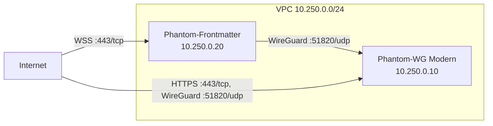

# AWS EC2 Üzerinde Phantom-WG

Bu dizin, Phantom-WG'nin temel sunucu topolojisini AWS EC2 üzerinde kuran bir Ansible Playbook içerir. Playbook tek komutla çalışır ve iki düğüm kurar. Düğümlerden birine Phantom-WG Modern, diğerine Phantom-Frontmatter yüklenir. Koşu, kurulumun nasıl kullanılacağını anlatan bir kılavuzla biter.



Phantom-Frontmatter, Phantom-WG Modern sunucusuna VPC içinden, özel adresi üzerinden ulaşır. Taşıma katmanı isteğe bağlıdır. Bu yüzden Phantom-WG Modern sunucusunun WireGuard portu internete de açıktır.

## Ne Kurar

AWS tarafındaki kaynakların tamamı tek bir CloudFormation stack'i (birlikte oluşturulan ve birlikte silinen kaynak grubu) içinde kurulur.

| Kaynak                     | Detay                                                            |
|----------------------------|------------------------------------------------------------------|
| VPC                        | `10.250.0.0/24` ve Amazon'un verdiği bir IPv6 bloğu              |
| Subnet                     | Tek subnet. IPv4 bloğunun tamamı, IPv6 bloğunun ilk `/64` dilimi |
| Internet gateway           | IPv4 ve IPv6 için varsayılan rota                                |
| Modern güvenlik grubu      | `443/tcp`, `80/tcp`, `51820/udp`, `22/tcp`                       |
| Front güvenlik grubu       | `443/tcp`, `80/tcp`, `22/tcp`                                    |
| Key pair                   | Koşunun ürettiği SSH anahtar çiftinin public key'i               |
| Phantom-WG Modern düğümü   | Debian 13 amd64, `t3.small`, 20 GiB `gp3` disk, `10.250.0.10`    |
| Phantom-Frontmatter düğümü | Debian 13 amd64, `t3.micro`, `10.250.0.20`                       |
| Elastic IP                 | İki sabit public IPv4 adresi, her düğüme bir tane                |

Güvenlik gruplarındaki bütün kurallar IPv4 ve IPv6 üzerinde her adrese açıktır. Gruplar kurulumun çatısını oluşturur. Bir kuralı daraltmak operatörün tercihidir.

Stack tamamlandığında playbook düğümlere SSH ile bağlanır ve iki ürünü kendi kurulum belgelerindeki adımlarla kurar.

| Düğüm               | Kurulum                                                                                              |
|---------------------|------------------------------------------------------------------------------------------------------|
| Phantom-WG Modern   | Docker, `main` dalının klonu, `./tools/prod.sh setup`, endpoint adresleri, `./tools/prod.sh up`      |
| Phantom-Frontmatter | `frontmatter-v1.0.2` arşivi, `frontmatter-install.sh`, backend tanımı, `frontmatter-api ghost start` |

Docker paketleri, Phantom-WG Modern kurulum matrisinin koştuğu sürümlere sabitlenmiştir. Phantom-Frontmatter arşivi SHA-256 değeriyle denetlenir. Phantom-Frontmatter arka uç noktası Phantom-WG Modern'in VPC içindeki adresidir.

## Gereksinimler

| Gereksinim | Detay                                                                                    |
|------------|------------------------------------------------------------------------------------------|
| Ansible    | `ansible` 14.6.0. `amazon.aws` ve `community.crypto` koleksiyonları bu paketin içindedir |
| Python     | 3.12 veya üstü, `boto3` ile                                                              |
| SSH        | OpenSSH istemcisi                                                                        |
| Ağ         | Düğümlerin `22/tcp` ve `443/tcp` portlarına çıkış                                        |
| AWS hesabı | CloudFormation ve EC2 üzerinde kaynak oluşturabilen kimlik bilgileri                     |
| Elastic IP | Bölgede kullanılabilir iki Elastic IP. Varsayılan kota bölge başına beştir               |

`requirements.txt`, iki Python paketini sürümleriyle taşır.

```bash
python3 -m venv ~/.venvs/phantom-wg
source ~/.venvs/phantom-wg/bin/activate
pip install -r requirements.txt
```

## Çalıştırma

### 1. İndirme

```bash
git clone --depth 1 --branch provision https://github.com/ARAS-Workspace/phantom-wg.git
cd phantom-wg/aws-ec2
```

### 2. Yapılandırma

`vars.yml`, operatörün değiştirebileceği değerleri taşır. Değerler ilk koşudan önce değiştirilir. Playbook var olan bir stack'i güncellemez.

| Değişken               | Varsayılan     | Açıklama                                                  |
|------------------------|----------------|-----------------------------------------------------------|
| `region`               | `eu-central-1` | Kurulumun yapılacağı AWS bölgesi (Region)                 |
| `stack_name`           | `phantom-wg`   | Stack'in, key pair'in ve `private/` altındaki dizinin adı |
| `modern_instance_type` | `t3.small`     | Phantom-WG Modern düğümünün instance tipi                 |
| `modern_volume_size`   | `20`           | Phantom-WG Modern düğümünün disk boyutu (GiB)             |
| `front_instance_type`  | `t3.micro`     | Phantom-Frontmatter düğümünün instance tipi               |

Docker paketlerinin sürümleri ve Phantom-Frontmatter release'i de aynı dosyadadır.

### 3. Koşu

```bash
ansible-playbook playbook.yml
```

Komut bu dizinde çalıştırılır. Ansible, `ansible.cfg` dosyasını komutun çalıştırıldığı dizinden okur.

AWS kimlik bilgileri `boto3`'ün standart zincirinden okunur. Ortam değişkenleri (örneğin `AWS_PROFILE`), `~/.aws/credentials` dosyası ve profiller bu zincirin parçasıdır.

## Kılavuz

Koşu bir kılavuzla biter. Kılavuz ekrana basılır ve `private/<stack_name>/guide.txt` dosyasına yazılır.

| Bölüm                           | İçerik                                                                      |
|---------------------------------|-----------------------------------------------------------------------------|
| Dashboard                       | Kontrol panelinin adresi, kullanıcı adı ve şifreyi düğümden okuyan komut    |
| Clients                         | İstemcinin doğrudan bağlantısı ve Phantom-Frontmatter'ın `[Wstunnel]` bloğu |
| Shell                           | İki düğümün SSH komutları                                                   |
| From here on the setup is yours | Kurulumdan sonra operatöre kalanlar                                         |

`private/<stack_name>/` dizini bu kuruluma ait dosyaları tutar.

| Dosya                          | İçerik                                                                                   |
|--------------------------------|------------------------------------------------------------------------------------------|
| `id_ed25519`, `id_ed25519.pub` | Koşunun ürettiği SSH anahtarı. İki düğüm `admin` kullanıcısı için bu anahtarı kabul eder |
| `known_hosts`                  | İki düğümün host anahtarları                                                             |
| `guide.txt`                    | Kılavuz. `[Wstunnel]` bloğunun `Secret` değerini taşır                                   |

## Yeniden Çalıştırma

Playbook önce stack'i arar. Stack varsa ona dokunmaz ve düğümlerdeki kurulumla devam eder. Yarıda kalan bir kurulum aynı komutla sürdürülür.

Stack `CREATE_COMPLETE` durumunda değilse playbook durur ve durumu bildirir. Bu stack'i silmek operatöre aittir.

## Kaldırma

Playbook hiçbir kaynağı silmez. Kurulumu kaldırmak için stack ve `private/<stack_name>/` dizini silinir. Stack, AWS konsolundan ya da AWS CLI ile silinir.

```bash
aws cloudformation delete-stack --stack-name phantom-wg --region eu-central-1
rm -r private/phantom-wg
```

## Kapsam

Bu set yalnızca temel topolojiyi kurar. Aşağıdaki işler operatöre bırakılmıştır.

- Güvenlik gruplarının daraltılması. SSH dahil bütün portlar her adrese açık kurulur.
- Kendi SSH anahtarınızın düğümlere tanımlanması. Her kurulum kendi anahtarını üretir.
- Alan adı ve Let's Encrypt sertifikası. İki güvenlik grubunda da 80 portu bu iş için açıktır.
- Exit (multihop) yapılandırması.
- Güncelleme. İki ürün de kendi komutuyla güncellenir.

İki ürünün kurulum belgeleri aşağıdadır.

| Ürün                | Belge                                                                        |
|---------------------|------------------------------------------------------------------------------|
| Phantom-WG Modern   | [SETUP](https://github.com/ARAS-Workspace/phantom-wg/blob/main/SETUP)        |
| Phantom-Frontmatter | [SETUP](https://github.com/ARAS-Workspace/phantom-wg/blob/frontmatter/SETUP) |

## Dizin

| Dosya                                 | İçerik                                                                              |
|---------------------------------------|-------------------------------------------------------------------------------------|
| `playbook.yml`                        | Dört play (playbook bölümü): stack, Phantom-WG Modern, Phantom-Frontmatter, kılavuz |
| `stack.yaml`                          | CloudFormation şablonu                                                              |
| `tasks/modern.yml`, `tasks/front.yml` | Düğümlerdeki kurulum adımları                                                       |
| `guide.j2`                            | Kılavuzun metni                                                                     |
| `vars.yml`                            | Operatörün değiştirebileceği değerler ve sabitlenmiş sürümler                       |
| `ansible.cfg`, `inventory.yml`        | Ansible'ın bu dizindeki ayarları                                                    |
| `requirements.txt`                    | Koşuyu yapan makinenin Python paketleri                                             |
