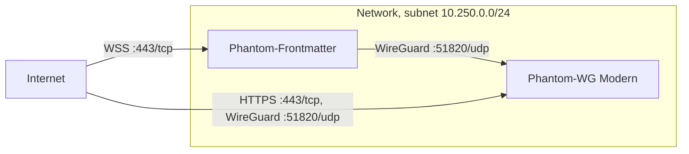

# Phantom-WG on Hetzner Cloud

This directory holds an Ansible Playbook that sets up the basic server topology of Phantom-WG on Hetzner Cloud. The playbook runs with one command and sets up two nodes. Phantom-WG Modern is installed on one of the nodes, Phantom-Frontmatter on the other. The run ends with a guide that tells how to use the setup.



Phantom-Frontmatter reaches the Phantom-WG Modern server inside the Network (the network that links servers to each other over private addresses), over its address on that network. The transport layer is optional. For this reason the WireGuard port of the Phantom-WG Modern server is open to the internet as well.

## What It Sets Up

All of the resources on the Hetzner side are set up in a single project and in a single location.

| Resource                   | Detail                                                                  |
|----------------------------|-------------------------------------------------------------------------|
| SSH key                    | The public key of the SSH key pair the run generates                    |
| Network                    | `10.250.0.0/16`                                                         |
| Subnet                     | One subnet, `10.250.0.0/24`. The two nodes take their addresses from it |
| Modern firewall            | `443/tcp`, `80/tcp`, `51820/udp`, `22/tcp`                              |
| Front firewall             | `443/tcp`, `80/tcp`, `22/tcp`                                           |
| Phantom-WG Modern server   | Debian 13, `cpx22`                                                      |
| Phantom-Frontmatter server | Debian 13, `cpx02`                                                      |
| Primary IP                 | A public IPv4 address and an IPv6 `/64` block for each server           |

Every rule in the firewalls is open to every address, over IPv4 and IPv6. The firewalls form the frame of the setup. Narrowing a rule is the operator's choice.

When the servers are set up, the playbook connects to the nodes over SSH and installs the two products with the steps of their own setup documents.

| Node                | Installation                                                                                                      |
|---------------------|-------------------------------------------------------------------------------------------------------------------|
| Phantom-WG Modern   | Docker, a clone of the `main` branch, `./tools/prod.sh setup`, the endpoint addresses, `./tools/prod.sh up`       |
| Phantom-Frontmatter | The `frontmatter-v1.0.2` archive, `frontmatter-install.sh`, the backend definition, `frontmatter-api ghost start` |

The Docker packages are pinned to the versions the Phantom-WG Modern install matrix ran. The Phantom-Frontmatter archive is checked against its SHA-256 value. The backend endpoint of Phantom-Frontmatter is the address of Phantom-WG Modern inside the Network.

## Requirements

| Requirement           | Detail                                                                                             |
|-----------------------|----------------------------------------------------------------------------------------------------|
| Ansible               | `ansible` 14.6.0. The `hetzner.hcloud` and `community.crypto` collections are part of this package |
| Python                | 3.12 or newer, with `python-dateutil` and `requests`                                               |
| SSH                   | OpenSSH client                                                                                     |
| Network               | Outbound access to ports `22/tcp` and `443/tcp` of the nodes                                       |
| Hetzner Cloud project | An API token of the project with the `Read & Write` permission                                     |

`requirements.txt` carries the three Python packages with their versions.

```bash
python3 -m venv ~/.venvs/phantom-wg
source ~/.venvs/phantom-wg/bin/activate
pip install -r requirements.txt
```

## Running

### 1. Download

```bash
git clone --depth 1 --branch provision https://github.com/ARAS-Workspace/phantom-wg.git
cd phantom-wg/hetzner-cloud
```

### 2. Configuration

`vars.yml` carries the values the operator can change. The values are changed before the first run. The playbook does not update the two existing nodes or their resources.

| Variable             | Default      | Description                                                     |
|----------------------|--------------|-----------------------------------------------------------------|
| `location`           | `nbg1`       | The Hetzner location the two nodes are set up in                |
| `setup_name`         | `phantom-wg` | The name of the resources and of the directory under `private/` |
| `modern_server_type` | `cpx22`      | The server type of the Phantom-WG Modern server                 |
| `front_server_type`  | `cpx02`      | The server type of the Phantom-Frontmatter server               |

The two nodes are set up in the same location. Both server types have to be x86 types that location has. If one of the types is not there in the location, the playbook stops without creating any resource.

The versions of the Docker packages and the Phantom-Frontmatter release are in the same file.

### 3. Run

```bash
read -rs HCLOUD_TOKEN && export HCLOUD_TOKEN
ansible-playbook playbook.yml
```

The first command asks for the API token and puts it in the `HCLOUD_TOKEN` environment variable. The token is not shown on the screen. The playbook reads the token from this variable.

The token is generated in the Hetzner Console, on the API tokens page of the Security section of the project.

The commands are run in this directory. Ansible reads `ansible.cfg` from the directory the command is run in.

## Guide

The run ends with a guide. The guide is printed on the screen and written to `private/<setup_name>/guide.txt`.

| Section                         | Content                                                                                                   |
|---------------------------------|-----------------------------------------------------------------------------------------------------------|
| Dashboard                       | The address of the dashboard, the username and the command that reads the password from the node          |
| Clients                         | The direct connection of a client, the `[Wstunnel]` block of Phantom-Frontmatter and the MTU of that path |
| Shell                           | The SSH commands of the two nodes                                                                         |
| From here on the setup is yours | What is left to the operator after the setup                                                              |

A client that connects through Phantom-Frontmatter uses `MTU = 1370` in its configuration. The Network between the two nodes carries packets of 1450 bytes.

The `private/<setup_name>/` directory holds the files that belong to this setup.

| File                           | Content                                                                          |
|--------------------------------|----------------------------------------------------------------------------------|
| `id_ed25519`, `id_ed25519.pub` | The SSH key the run generates. The two nodes accept this key for the user `root` |
| `known_hosts`                  | The host keys of the two nodes                                                   |
| `guide.txt`                    | The guide. It carries the `Secret` value of the `[Wstunnel]` block               |

## Running Again

The playbook first looks for the two nodes. If both are there, the playbook does not touch the resources on the Hetzner side and goes on with the installation on the nodes. An installation that stopped halfway is continued with the same command.

## Removal

The playbook deletes no resource. To remove the setup, the resources below are deleted in the Hetzner Console, then the `private/<setup_name>/` directory is deleted. The servers are deleted before the firewalls.

| Resource  | Name                                    |
|-----------|-----------------------------------------|
| Servers   | `phantom-wg-modern`, `phantom-wg-front` |
| Firewalls | `phantom-wg-modern`, `phantom-wg-front` |
| Network   | `phantom-wg`                            |
| SSH key   | `phantom-wg`                            |

```bash
rm -r private/phantom-wg
```

## Scope

This set sets up the basic topology only. The following is left to the operator.

- Narrowing the firewall rules. Every port, SSH included, is set up open to every address.
- Putting your own SSH key on the nodes. Each setup generates its own key.
- A domain name and a Let's Encrypt certificate. Port 80 is open in both firewalls for this.
- The exit (multihop) configuration.
- Updates. Each of the two products is updated with its own command.

The setup documents of the two products are below.

| Product             | Document                                                                     |
|---------------------|------------------------------------------------------------------------------|
| Phantom-WG Modern   | [SETUP](https://github.com/ARAS-Workspace/phantom-wg/blob/main/SETUP)        |
| Phantom-Frontmatter | [SETUP](https://github.com/ARAS-Workspace/phantom-wg/blob/frontmatter/SETUP) |

## Directory

| File                                  | Content                                                                                                           |
|---------------------------------------|-------------------------------------------------------------------------------------------------------------------|
| `playbook.yml`                        | Four plays (the sections of a playbook): the Hetzner resources, Phantom-WG Modern, Phantom-Frontmatter, the guide |
| `tasks/modern.yml`, `tasks/front.yml` | The installation steps on the nodes                                                                               |
| `guide.j2`                            | The text of the guide                                                                                             |
| `vars.yml`                            | The values the operator can change and the pinned versions                                                        |
| `ansible.cfg`, `inventory.yml`        | The settings of Ansible in this directory                                                                         |
| `requirements.txt`                    | The Python packages of the machine that makes the run                                                             |
