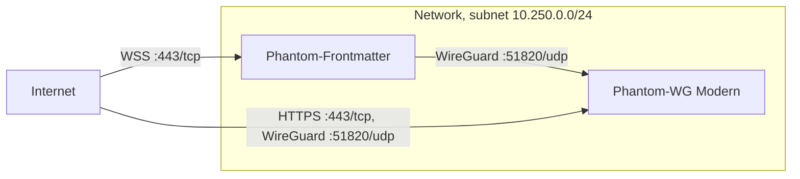

# Hetzner Cloud Üzerinde Phantom-WG

Bu dizin, Phantom-WG'nin temel sunucu topolojisini Hetzner Cloud üzerinde kuran bir Ansible Playbook içerir. Playbook tek komutla çalışır ve iki düğüm kurar. Düğümlerden birine Phantom-WG Modern, diğerine Phantom-Frontmatter yüklenir. Koşu, kurulumun nasıl kullanılacağını anlatan bir kılavuzla biter.



Phantom-Frontmatter, Phantom-WG Modern sunucusuna Network (sunucuları özel adreslerle birbirine bağlayan ağ) içinden, ağdaki adresi üzerinden ulaşır. Taşıma katmanı isteğe bağlıdır. Bu yüzden Phantom-WG Modern sunucusunun WireGuard portu internete de açıktır.

## Ne Kurar

Hetzner tarafındaki kaynakların tamamı tek bir projede ve tek bir konumda (Location) kurulur.

| Kaynak                       | Detay                                                        |
|------------------------------|--------------------------------------------------------------|
| SSH key                      | Koşunun ürettiği SSH anahtar çiftinin public key'i           |
| Network                      | `10.250.0.0/16`                                              |
| Subnet                       | Tek subnet, `10.250.0.0/24`. İki düğüm adresini buradan alır |
| Modern firewall'u            | `443/tcp`, `80/tcp`, `51820/udp`, `22/tcp`                   |
| Front firewall'u             | `443/tcp`, `80/tcp`, `22/tcp`                                |
| Phantom-WG Modern sunucusu   | Debian 13, `cpx22`                                           |
| Phantom-Frontmatter sunucusu | Debian 13, `cpx02`                                           |
| Primary IP                   | Her sunucuya bir public IPv4 adresi ve bir IPv6 `/64` bloğu  |

Firewall'lardaki bütün kurallar IPv4 ve IPv6 üzerinde her adrese açıktır. Firewall'lar kurulumun çatısını oluşturur. Bir kuralı daraltmak operatörün tercihidir.

Sunucular kurulduğunda playbook düğümlere SSH ile bağlanır ve iki ürünü kendi kurulum belgelerindeki adımlarla kurar.

| Düğüm               | Kurulum                                                                                              |
|---------------------|------------------------------------------------------------------------------------------------------|
| Phantom-WG Modern   | Docker, `main` dalının klonu, `./tools/prod.sh setup`, endpoint adresleri, `./tools/prod.sh up`      |
| Phantom-Frontmatter | `frontmatter-v1.0.2` arşivi, `frontmatter-install.sh`, backend tanımı, `frontmatter-api ghost start` |

Docker paketleri, Phantom-WG Modern kurulum matrisinin koştuğu sürümlere sabitlenmiştir. Phantom-Frontmatter arşivi SHA-256 değeriyle denetlenir. Phantom-Frontmatter arka uç noktası Phantom-WG Modern'in Network içindeki adresidir.

## Gereksinimler

| Gereksinim            | Detay                                                                                        |
|-----------------------|----------------------------------------------------------------------------------------------|
| Ansible               | `ansible` 14.6.0. `hetzner.hcloud` ve `community.crypto` koleksiyonları bu paketin içindedir |
| Python                | 3.12 veya üstü, `python-dateutil` ve `requests` ile                                          |
| SSH                   | OpenSSH istemcisi                                                                            |
| Ağ                    | Düğümlerin `22/tcp` ve `443/tcp` portlarına çıkış                                            |
| Hetzner Cloud projesi | Projenin `Read & Write` yetkili API token'ı                                                  |

`requirements.txt`, üç Python paketini sürümleriyle taşır.

```bash
python3 -m venv ~/.venvs/phantom-wg
source ~/.venvs/phantom-wg/bin/activate
pip install -r requirements.txt
```

## Çalıştırma

### 1. İndirme

```bash
git clone --depth 1 --branch provision https://github.com/ARAS-Workspace/phantom-wg.git
cd phantom-wg/hetzner-cloud
```

### 2. Yapılandırma

`vars.yml`, operatörün değiştirebileceği değerleri taşır. Değerler ilk koşudan önce değiştirilir. Playbook var olan iki düğümü ve kaynaklarını güncellemez.

| Değişken             | Varsayılan   | Açıklama                                        |
|----------------------|--------------|-------------------------------------------------|
| `location`           | `nbg1`       | İki düğümün kurulacağı Hetzner konumu           |
| `setup_name`         | `phantom-wg` | Kaynakların ve `private/` altındaki dizinin adı |
| `modern_server_type` | `cpx22`      | Phantom-WG Modern sunucusunun tipi              |
| `front_server_type`  | `cpx02`      | Phantom-Frontmatter sunucusunun tipi            |

İki düğüm aynı konumda kurulur. İki sunucu tipi de o konumda bulunan x86 tipler olmalıdır. Tiplerden biri konumda yoksa playbook hiçbir kaynak oluşturmadan durur.

Docker paketlerinin sürümleri ve Phantom-Frontmatter release'i de aynı dosyadadır.

### 3. Koşu

```bash
read -rs HCLOUD_TOKEN && export HCLOUD_TOKEN
ansible-playbook playbook.yml
```

İlk komut API token'ını sorar ve `HCLOUD_TOKEN` ortam değişkenine koyar. Token ekrana yazılmaz. Playbook token'ı bu değişkenden okur.

Token, Hetzner Console'da projenin Security bölümündeki API tokens sayfasında üretilir.

Komutlar bu dizinde çalıştırılır. Ansible, `ansible.cfg` dosyasını komutun çalıştırıldığı dizinden okur.

## Kılavuz

Koşu bir kılavuzla biter. Kılavuz ekrana basılır ve `private/<setup_name>/guide.txt` dosyasına yazılır.

| Bölüm                           | İçerik                                                                                       |
|---------------------------------|----------------------------------------------------------------------------------------------|
| Dashboard                       | Kontrol panelinin adresi, kullanıcı adı ve şifreyi düğümden okuyan komut                     |
| Clients                         | İstemcinin doğrudan bağlantısı, Phantom-Frontmatter'ın `[Wstunnel]` bloğu ve bu yolun MTU'su |
| Shell                           | İki düğümün SSH komutları                                                                    |
| From here on the setup is yours | Kurulumdan sonra operatöre kalanlar                                                          |

Phantom-Frontmatter üzerinden bağlanan istemcinin yapılandırmasında `MTU = 1370` kullanılır. İki düğüm arasındaki Network 1450 baytlık paket taşır.

`private/<setup_name>/` dizini bu kuruluma ait dosyaları tutar.

| Dosya                          | İçerik                                                                                  |
|--------------------------------|-----------------------------------------------------------------------------------------|
| `id_ed25519`, `id_ed25519.pub` | Koşunun ürettiği SSH anahtarı. İki düğüm `root` kullanıcısı için bu anahtarı kabul eder |
| `known_hosts`                  | İki düğümün host anahtarları                                                            |
| `guide.txt`                    | Kılavuz. `[Wstunnel]` bloğunun `Secret` değerini taşır                                  |

## Yeniden Çalıştırma

Playbook önce iki düğümü arar. İkisi de varsa Hetzner tarafındaki kaynaklara dokunmaz ve düğümlerdeki kurulumla devam eder. Yarıda kalan bir kurulum aynı komutla sürdürülür.

## Kaldırma

Playbook hiçbir kaynağı silmez. Kurulumu kaldırmak için aşağıdaki kaynaklar Hetzner Console'dan silinir, ardından `private/<setup_name>/` dizini silinir. Sunucular firewall'lardan önce silinir.

| Kaynak       | Ad                                      |
|--------------|-----------------------------------------|
| Sunucular    | `phantom-wg-modern`, `phantom-wg-front` |
| Firewall'lar | `phantom-wg-modern`, `phantom-wg-front` |
| Network      | `phantom-wg`                            |
| SSH key      | `phantom-wg`                            |

```bash
rm -r private/phantom-wg
```

## Kapsam

Bu set yalnızca temel topolojiyi kurar. Aşağıdaki işler operatöre bırakılmıştır.

- Firewall kurallarının daraltılması. SSH dahil bütün portlar her adrese açık kurulur.
- Kendi SSH anahtarınızın düğümlere tanımlanması. Her kurulum kendi anahtarını üretir.
- Alan adı ve Let's Encrypt sertifikası. İki firewall'da da 80 portu bu iş için açıktır.
- Exit (multihop) yapılandırması.
- Güncelleme. İki ürün de kendi komutuyla güncellenir.

İki ürünün kurulum belgeleri aşağıdadır.

| Ürün                | Belge                                                                        |
|---------------------|------------------------------------------------------------------------------|
| Phantom-WG Modern   | [SETUP](https://github.com/ARAS-Workspace/phantom-wg/blob/main/SETUP)        |
| Phantom-Frontmatter | [SETUP](https://github.com/ARAS-Workspace/phantom-wg/blob/frontmatter/SETUP) |

## Dizin

| Dosya                                 | İçerik                                                                                           |
|---------------------------------------|--------------------------------------------------------------------------------------------------|
| `playbook.yml`                        | Dört play (playbook bölümü): Hetzner kaynakları, Phantom-WG Modern, Phantom-Frontmatter, kılavuz |
| `tasks/modern.yml`, `tasks/front.yml` | Düğümlerdeki kurulum adımları                                                                    |
| `guide.j2`                            | Kılavuzun metni                                                                                  |
| `vars.yml`                            | Operatörün değiştirebileceği değerler ve sabitlenmiş sürümler                                    |
| `ansible.cfg`, `inventory.yml`        | Ansible'ın bu dizindeki ayarları                                                                 |
| `requirements.txt`                    | Koşuyu yapan makinenin Python paketleri                                                          |
